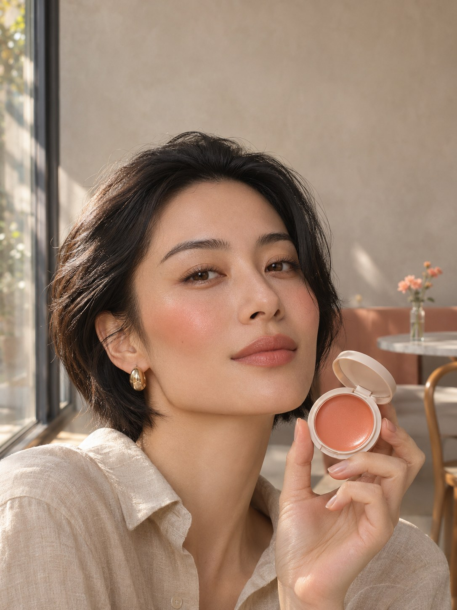

# 案例：蜜桃色腮红膏 · 城市午后

用现行 Skill 在 Codex 里跑一次真实流程：一句需求 → Skill 给 3 个方向 → 选一个 → Skill 写提示词并出 1 张图。下面的方向、提示词与成图都是原样输出。

## 1. 需求（原话）

> 为一款蜜桃色腮红膏拍带模特的广告大片，用于小红书首图（3:4），面向 25–35 岁女性，品牌定位轻熟、自然。先给我 3 个方向让我挑，这一步只要文字方向，不要生成任何图片。

## 2. Skill 给出的 3 个方向（原文）

> 三个方向都以**蜜桃色上脸效果**为视觉中心，采用 3:4 竖构图，保留真实肌肤纹理，传达轻熟、自然的气质。以下妆效为创意设想，具体光泽度后续以产品实际质地为准。
>
> **方向一｜晨间窗边 · 好气色刚刚醒来**
>
> - **场景与人物：** 清晨的公寓窗边，30 岁虚构成年女性，深棕锁骨发、暖白肤色、棕色眼睛，眉形舒展。穿米白色细针织，呈现准备出门时的松弛状态。
> - **妆容与色彩：** 蜜桃色从面颊自然晕开，眼妆轻淡、唇色柔和；奶油白、浅木色构成安静背景。
> - **首图构图：** 面部至肩部近景，脸颊成为第一视觉落点，背景只留一点窗帘与居家线索，上方预留标题空间。
> - **吸引点：** 将产品融入日常，让人向往“每天都能拥有的自然好气色”。
>
> **方向二｜城市午后 · 温柔也有主见**
>
> - **场景与人物：** 午后的城市咖啡馆临窗座位，32 岁虚构成年女性，利落黑色短发、中等暖肤色、深棕眼睛，颧骨轮廓清晰。穿浅燕麦色衬衫，神情从容。
> - **妆容与色彩：** 蜜桃色沿颧骨柔和铺开，保留面部轮廓；以燕麦色、石灰色搭配一小片蜜桃暖色，减少甜腻感。
> - **首图构图：** 胸像偏近景，人物占画面约三分之二，咖啡馆化为简洁背景，侧上方留出文案位置。
> - **吸引点：** 更贴近轻熟通勤女性，表达有精神、有亲和力的都市状态。
>
> **方向三｜梳妆台前 · 一抹蜜桃的亲密时刻**
>
> - **场景与人物：** 傍晚出门前的梳妆台边，28 岁虚构成年女性，黑色长发自然拢起、浅暖肤色、深棕眼睛，鼻梁带少量雀斑。穿简洁米杏色上衣，有轻微笑意。
> - **妆容与色彩：** 聚焦蜜桃腮红与肌肤融合的柔润感；浅陶土色、米杏色与低饱和桃色形成统一色调。
> - **首图构图：** 面部特写为主，捕捉指腹轻触脸颊的补妆瞬间；画面下缘可带入少量腮红膏道具，上侧留白。
> - **吸引点：** “膏状腮红”的使用联想最直接，既有亲近感，也便于突出产品类别。
>
> **我更推荐方向二**：轻熟定位最鲜明，蜜桃色也能呈现从容、有质感的一面。你想选 **1、2 还是 3**？

## 3. 选择

方向二「城市午后 · 温柔也有主见」（Skill 推荐的方向）。回复："按这个方向出图，恰好生成 1 张。"

## 4. Skill 写出的最终提示词（原文）

```text
Create one 3:4 vertical high-end beauty advertising photograph for a peach cream blush, a Xiaohongshu cover aimed at women aged 25–35 with a naturally sophisticated brand positioning.
Set it in a city café window seat in the afternoon, lit by its own real daylight, with a simple softly receding café background in oatmeal and limestone gray accented by a small area of warm peach, feeling like a luxury cosmetics campaign: composed, warm, self-assured.
The model is a fictional synthetic 32-year-old adult woman with sleek short black hair, medium warm skin, deep brown eyes, and clearly defined cheekbones, wearing a light oatmeal shirt with a calm expression, strikingly beautiful.
Compose it with a close bust portrait of her occupying approximately two thirds of the image, keeping clear soft background space toward the upper side for logo and headline, without shrinking the beauty result.
Show peach cream blush softly diffused along the cheekbones while preserving facial structure as the hero look; make its natural peach color and softly luminous cream finish rich and unmistakable, the product held by her or in the foreground, in elegant unbranded packaging.
Real skin texture, crisp detail. No logos, brand names, monograms or readable text; no extra products, collage or variations.
```

## 5. 成图



## 如实说明

- 只出了这 1 张：没有挑选、没有重抽、没有局部修补；发布时只做了缩放并转为 JPEG。
- 模特是虚构的合成成年人；包装为无品牌通用包装。
- 产品拿在脸旁，是小红书首图的常见拍法；如需其他姿势，可在需求里写明。
- 每次运行的结果会不同；用于商业投放前，请逐张检查手、产品结构和包装上是否出现类似真实品牌的标志。
