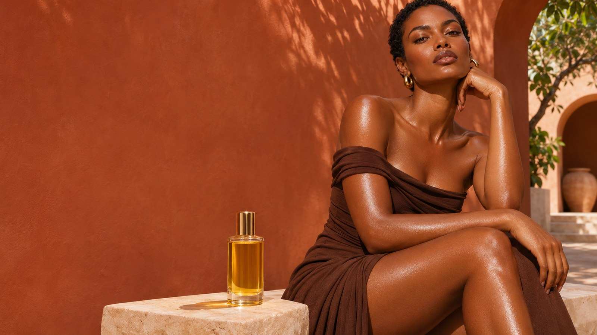

# 案例：身体精华油 · 赤陶暖夏

用现行 Skill 在 Codex 里跑一次真实流程：一句需求 → Skill 给 3 个方向 → 选一个 → Skill 写提示词并出 1 张图。下面的方向、提示词与成图都是原样输出。

## 1. 需求（原话）

> 为一瓶身体精华油拍带模特的广告大片，主打夏季光泽肌，用于品牌官网首屏横幅（16:9），面向 25–35 岁女性。先给我 3 个方向让我挑，这一步只要文字方向，不要生成任何图片。

## 2. Skill 给出的 3 个方向（原文）

> 三个方向都围绕 **“夏天愿意露出的光泽肌”**：让肩颈、手臂或腿部呈现细腻光泽，保留真实皮肤质感。均按 **16:9 官网首屏**设计，人物与产品集中在一侧，另一侧留出标题及购买按钮空间。以下人物均为虚构成年模特设定。
>
> **01｜海岸金光：把假日的光穿在身上**
>
> - **场景与瞬间：** 夏日傍晚的海边露台，奶油色墙面、远处浅蓝海面；模特准备赴一场日落晚餐，肌肤带着柔润的金色光泽。
> - **模特设定：** 29 岁，暖小麦肤色，深棕色及肩卷发、棕眼，鼻梁有少量雀斑；穿简洁象牙白露肩裙，气质松弛而自信。
> - **画面与产品：** 人物位于右侧，以肩颈至大腿的中景呈现肌肤；精华油放在身旁石质矮台上，与人物形成视觉联系，左侧保留干净墙面。
> - **商业吸引力：** 用令人向往的度假状态带动购买欲，适合温暖、感性、有生活方式气质的品牌。
>
> **02｜清晨白纱：日常里的精致身体护理**
>
> - **场景与瞬间：** 城市公寓的夏日清晨，浅色窗帘、白棉床品与淡木色家具；出门前完成身体护理，肌肤呈现清透、细密的缎面光泽。
> - **模特设定：** 32 岁，自然浅橄榄肤色，黑色短发、深棕眼，眉形清晰；穿浅灰白色无袖家居套装，神态从容。
> - **画面与产品：** 人物坐在床沿，安排在画面左侧，肩臂与小腿形成肌肤展示区域；产品置于近旁床头台，右侧浅色窗帘为文案留白。
> - **商业吸引力：** 将产品融入可代入的日常仪式，适合强调细致护理、简约审美与都市生活的品牌。
>
> **03｜赤陶暖夏：肌肤就是最好的夏日配饰**
>
> - **场景与瞬间：** 夏日午后的设计酒店庭院，赤陶墙、浅砂色石凳；模特赴约前短暂停留，肌肤的柔亮光泽成为造型焦点。
> - **模特设定：** 28 岁，深棕肤色，黑色极短卷发、琥珀棕眼，颧骨鲜明；穿极简巧克力色露肩连衣裙，气质鲜明、有力量。
> - **画面与产品：** 人物居右，以头部至膝上的构图突出肩颈、手臂与腿部；产品置于前景石台，左侧大片赤陶墙承接标题。
> - **商业吸引力：** 赤陶、深棕与肌肤光泽形成强烈识别度，适合时装感更强、希望首屏具有视觉冲击力的品牌。
>
> 我更推荐 **03**，首屏辨识度更强；偏度假向往选 **01**，偏日常护理选 **02**。你想先深化哪一个？

## 3. 选择

方向 03「赤陶暖夏：肌肤就是最好的夏日配饰」（Skill 推荐的方向）。回复："按这个方向出图，恰好生成 1 张。"

## 4. Skill 写出的最终提示词（原文）

```text
Create one 16:9 brand website hero banner high-end beauty advertising photograph for a bottle of body serum oil, aimed at women aged 25–35.
Set it in a design hotel's summer courtyard in the afternoon, with terracotta walls and a pale sand-coloured stone bench, at the moment of a brief pause before going out to meet someone, lit by its own real afternoon sunlight, feeling like a luxury cosmetics campaign: bold, warm, fashion-forward.
The model is a fictional synthetic adult woman aged 28, with deep brown skin, extremely short black curly hair, amber-brown eyes and striking cheekbones, wearing a minimalist chocolate-brown off-shoulder dress, with a strong confident presence, strikingly beautiful.
Compose it with her on the right, framed from the top of her head to above her knees to showcase her shoulders, neckline, arms and visible legs, keeping a large uncluttered expanse of terracotta wall on the left for logo and headline, without shrinking the beauty result.
Show softly luminous summer skin on her shoulders, neckline, arms and legs as the hero look; make its supple deep-brown glow and refined oil sheen rich and unmistakable, the product held by her or in the foreground, in elegant unbranded packaging.
Real skin texture, crisp detail. No logos, brand names, monograms or readable text; no extra products, collage or variations.
```

## 5. 成图



## 如实说明

- 只出了这 1 张：没有挑选、没有重抽、没有局部修补；发布时只做了缩放并转为 JPEG。
- 模特是虚构的合成成年人；包装为无品牌通用包装。
- 产品立在前景石台上，左侧整面赤陶墙留给标题与按钮。
- 每次运行的结果会不同；用于商业投放前，请逐张检查手、产品结构和包装上是否出现类似真实品牌的标志。
