# 案例：卸妆油 · 一个需求、三个方向、各 4 张

用 v0.1 Skill 在 Codex 里跑一次完整流程：用户附上产品照片，要一组 4 张的新品上市套图 → Skill 给 3 个方向，每个方向已规划好 4 张的分工 → 定下方向后，先出第 1 张，用户确认人物后，以它作为身份参考出另外 3 张。为了展示不同方向的差别，三个方向都按同样流程出完。下面的需求、方向、提示词与成图都是原样输出。

## 1. 产品照片

用户附上的是一张卸妆油产品照：乳白色圆柱按压瓶、弯嘴泵头，瓶身有一块空白贴标、没有品牌字样。照片来自 Pexels 免费图库（https://www.pexels.com/photo/white-cosmetic-plastic-pump-bottle-with-beige-background-7814990/ ），不随本仓库发布。

## 2. 需求（原话，附上产品照片）

> 这是我的卸妆油，附图是产品照片。请为它做一组新品上市的带模特广告大片，共 4 张，用于电梯海报（3:4）、电商详情页首图（1:1）和社交媒体信息流（4:5），面向 22–35 岁女性。先给我 3 个方向让我挑，这一步只要文字方向，不要生成任何图片。

## 3. Skill 给出的 3 个方向（原文）

> 建议把这组新品广告的核心放在 **“卸下妆容，回到自己的时刻”**，让产品与女性的日常情绪产生联系。
>
> 照片中可见的是乳白色修长泵瓶，外观简洁，适合做有质感的模特大片。原图的暖金色可以延续，也可以换成新的视觉体系。以下方向不预设成分、肤质适用性或卸妆功效。
>
> 4 张建议分配为：**电梯海报 1 张（3:4）＋电商详情首图 1 张（1:1）＋信息流 2 张（4:5）**。各张单独构图，均有模特，保留后期标题与品牌信息的位置。
>
> **方向一｜金色下班后**
>
> *温暖、松弛、有生活质感。*  
> 傍晚回家，窗边还留着最后一束阳光。模特换上奶油色家居服，在暖沙色浴室中准备卸妆。延续参考图的金色与乳白色，用石材、织物和空间阴影形成统一质感。
>
> 模特设定：虚构成年女性，约 28 岁，暖调中等肤色，深棕色及肩发、棕色眼睛，眉形舒展，保留自然雀斑。
>
> - **电梯海报｜3:4：** 模特靠在洗手台边，脸部与手边泵瓶共同成为视觉中心，上方留出清楚的标题区。
> - **电商首图｜1:1：** 产品位于前景台面，模特面部靠近同一视觉平面，让人同时看清人和瓶身。
> - **信息流一｜4:5：** 模特摘下耳饰的瞬间，产品在镜边，讲述一天结束、卸妆开始。
> - **信息流二｜4:5：** 模特将泵瓶拿近脸侧，温暖肤色与乳白瓶身形成简洁的近景。
>
> **适合：** 希望第一眼传达亲近、精致、日常仪式感的品牌。与现有产品照片衔接最自然。
>
> **方向二｜今晚，回到自己**
>
> *都市、私密、带一点电影感。*  
> 夜晚的公寓浴室，窗外城市灯光虚化。模特刚结束工作或聚会，仍保留完整妆容，正从外出的状态切换到独处。深墨蓝空间搭配柔和肤色与乳白瓶身，产品在画面里格外醒目。
>
> 模特设定：虚构成年女性，约 30 岁，中性调浅麦肤色，黑色锁骨短发、深棕眼睛，颧骨清晰，气质沉静。
>
> - **电梯海报｜3:4：** 模特正面半身肖像，泵瓶在胸口附近清晰出现；大面积深色背景承接标题，强调远距离识别。
> - **电商首图｜1:1：** 产品置于前景浅色台面，模特从后方进入画面，夜色背景衬托瓶身轮廓。
> - **信息流一｜4:5：** 镜前挽起头发、准备卸妆的侧面瞬间，产品在触手可及的位置。
> - **信息流二｜4:5：** 模特放下耳饰后看向镜头，另一只手自然持瓶，以眼神和产品建立记忆点。
>
> **适合：** 希望新品有鲜明态度、在信息流和电梯中更抓眼的品牌。重点是“属于自己的时间”。
>
> **方向三｜留白浴室**
>
> *明亮、简洁、当代设计感。*  
> 乳白与浅灰构成的浴室，加入少量透明玻璃和银色细节。模特穿简洁白色背心，头发利落收起。用面部、肩颈和泵瓶的比例关系，让日常卸妆呈现杂志封面的精致感。
>
> 模特设定：虚构成年女性，约 25 岁，深蜜色肤色，黑色卷发收成低髻、深棕眼睛，唇形饱满，保留真实皮肤纹理。
>
> - **电梯海报｜3:4：** 模特面部与肩颈近景，乳白瓶身置于脸侧，以有辨识度的肖像抓住视线。
> - **电商首图｜1:1：** 模特与产品并列构图，瓶身完整清晰，浅灰背景拉开白色包装的边界。
> - **信息流一｜4:5：** 模特在洗手台前按压泵头，聚焦开始卸妆的动作；料体表现待实物信息确认。
> - **信息流二｜4:5：** 镜面中的模特肖像与台面实物形成呼应，用留白和几何关系制造视觉变化。
>
> **适合：** 偏好极简审美、希望包装与人物都显得利落高级的品牌。
>
> 我更推荐 **方向二**：夜色与乳白泵瓶的反差更有新品上市的辨识度，“回到自己”也能贯穿四张图。你想选 **1、2 还是 3**？

## 4. 怎么出的图

- 每个方向分开出：第 1 张（电梯海报）只附产品照片；用户确认人物后，后 3 张都附两张图——附图 1 是第 1 张（只作人物身份参考），附图 2 是产品照片。
- 每张在单独的会话里出，提示词由 Skill 按模板自己写（下面每张图下可展开）；每张只出 1 次，没有挑选、没有重抽、没有局部修补，发布时只转成 JPEG。
- 方向三的第 1 张第一次运行时网络中断，没有出图，重跑了 1 次。

## 5. 方向二｜今晚，回到自己（Skill 推荐，用户选的这一个）

### 第 1 张：电梯海报 3:4

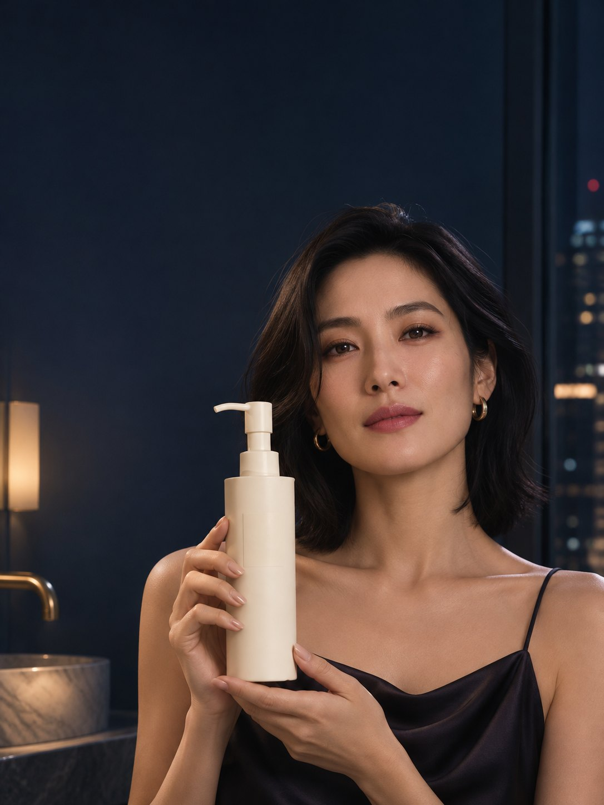

<details><summary>这一张的最终提示词</summary>

```text
Create one 3:4 vertical elevator poster high-end beauty advertising photograph for a cleansing oil in a tall opaque ivory cylindrical pump bottle, using Image 1 as product appearance reference only: ivory left-facing curved pump nozzle, stepped pump collar, subtly rounded cylinder base and blank tonal rectangular label.
Set it in a private urban apartment bathroom at night, just after she returns from work or an evening out, with soft bathroom illumination on her skin and distant city lights blurred through the window, feeling like a luxury cosmetics campaign: intimate, cinematic, serene.
The model is a fictional synthetic adult woman about 30 years old with neutral light wheat-toned skin, black collarbone-length short hair, dark brown eyes and defined cheekbones, strikingly beautiful.
Compose it with her facing forward in a half-body portrait, calmly meeting the camera, the ivory pump bottle clearly held near her chest at a believable size with its full silhouette and pump visible, wearing an elegant understated dark evening top, keeping a generous uninterrupted deep ink-blue area of wall and shadow above and beside her for logo and headline, without shrinking the beauty result.
Show her complete evening makeup still intact before cleansing, with subtly defined eyes and muted rose lips as the hero look; make its polished natural skin finish against the deep ink-blue bathroom rich and unmistakable, the product held by her or in the foreground, in elegant unbranded packaging.
Real skin texture, crisp detail. No logos, brand names, monograms or readable text; no extra products, collage or variations.
```

</details>

### 第 2 张：电商详情页首图 1:1

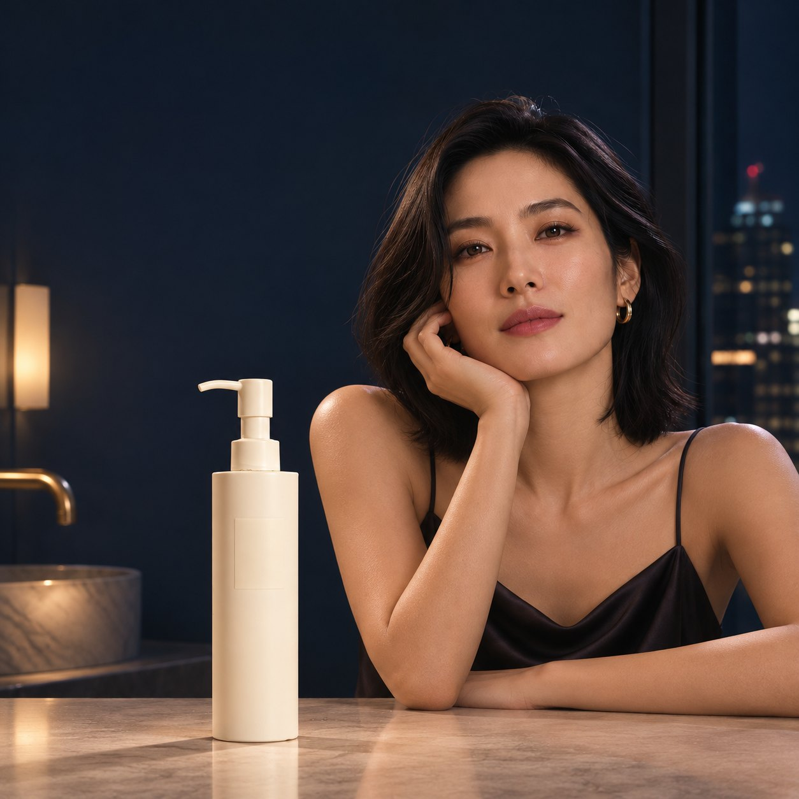

<details><summary>这一张的最终提示词</summary>

```text
Image 1 is the identity reference for the model.
Create one 1:1 square ecommerce detail-page hero high-end beauty advertising photograph for a cleansing oil in a tall ivory cylindrical pump bottle, with Image 2 serving as product appearance reference only: cream-white body, subtle blank rectangular label area, stepped pump collar and curved spout.
Set it in a private city apartment bathroom at night, just after returning home from work or an evening out, with blurred city lights through the window, deep ink-blue walls, a pale stone countertop and soft warm bathroom practical lighting, feeling like a luxury cosmetics campaign: intimate, urban, cinematic.
The model is the same fictional adult woman shown in Image 1, approximately 30 years old, with neutral light-wheat skin, black collarbone-length bob, deep brown eyes, defined cheekbones, a composed presence, black satin camisole and small gold hoop earrings, strikingly beautiful.
Compose it with the model entering the scene behind the countertop, visible from the upper torso upward and recognizably matching the identity reference, and the single upright ivory pump bottle clearly prominent and fully visible on the pale countertop in the foreground with a dark night background outlining its silhouette, keeping open deep-blue shadow space toward the upper side for logo and headline, without shrinking the beauty result.
Show her still-complete evening makeup, softly defined eyes and muted rose lips before beginning her cleansing ritual as the hero look; make its polished satin finish and warm natural skin tone rich and unmistakable, the product held by her or in the foreground, in elegant unbranded packaging.
Real skin texture, crisp detail. No logos, brand names, monograms or readable text; no extra products, collage or variations.
```

</details>

### 第 3 张：信息流一 4:5

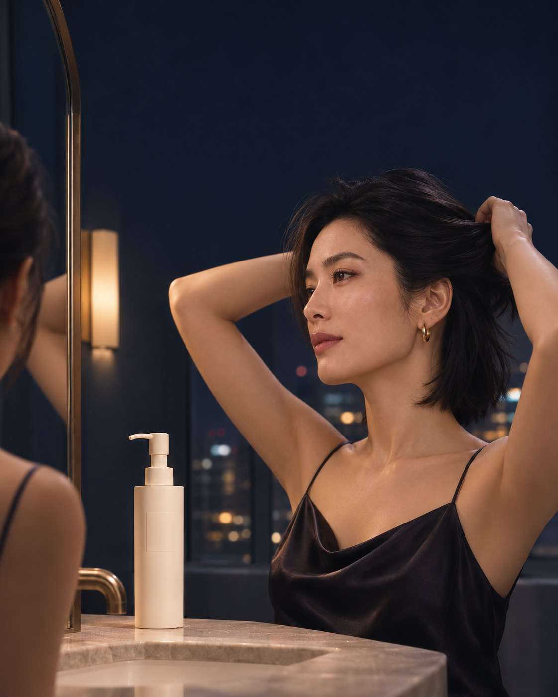

注意：她侧身看向左边的镜子，镜中却是后脑和肩膀，反射关系不成立。

<details><summary>这一张的最终提示词</summary>

```text
Image 1 is the identity reference for the model.
Create one 4:5 vertical social media feed high-end beauty advertising photograph for a cleansing oil in a tall ivory cylindrical pump bottle, with Image 2 used only as a product appearance reference for its plain cream bottle, stepped pump and small blank rectangular label.
Set it in a private urban apartment bathroom at night, just after she returns from work or an evening out, beside a mirror and a pale stone vanity, with defocused city lights through the window, deep ink-blue walls and soft warm bathroom light on her skin, feeling like a luxury cosmetics campaign: intimate, cinematic, serene.
The model is the same fictional adult woman from Image 1, approximately 30, with neutral light wheat skin, black collarbone-length bob hair, dark brown eyes and defined cheekbones, wearing a black satin camisole and small gold hoop earrings, strikingly beautiful.
Compose it with her upper body seen in profile at the bathroom mirror, quietly lifting and gathering her short hair away from her face in preparation for removing makeup, her gaze directed toward her reflection, the mirror integrated naturally into the scene and the upright cream pump bottle fully visible on the vanity in the foreground within easy arm's reach, keeping open deep-blue shadow space at the top for logo and headline, without shrinking the beauty result.
Show her still-complete evening makeup, softly defined eyes and muted rose lips, and luminous natural skin as the hero look; make its warm skin finish against the ink-blue evening atmosphere rich and unmistakable, the product held by her or in the foreground, in elegant unbranded packaging.
Real skin texture, crisp detail. No logos, brand names, monograms or readable text; no extra products, collage or variations.
```

</details>

### 第 4 张：信息流二 4:5

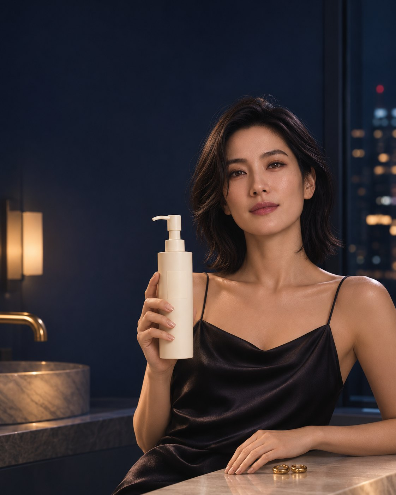

<details><summary>这一张的最终提示词</summary>

```text
Image 1 is the identity reference for the model.
Create one 4:5 vertical social media feed high-end beauty advertising photograph for cleansing oil in a tall ivory cylindrical bottle with a matching ivory pump and curved spout, using Image 2 as the product appearance reference only.
Set it in a private apartment bathroom at night, just after she has returned from work or an evening out, with defocused city lights beyond the window, deep ink-blue walls, a pale stone vanity and warm bathroom practical lighting on her skin, feeling like a luxury cosmetics campaign: urban, intimate, cinematic.
The model is the same fictional adult woman seen in Image 1, approximately 30 years old, with neutral light-wheat skin, black collarbone-length hair, dark brown eyes and defined cheekbones, strikingly beautiful.
Compose it with her visible from the waist up in a black satin camisole, looking directly into the camera with a quiet, self-possessed expression just after setting down her small gold hoop earrings on the vanity, her ears now bare, one hand resting beside the earrings and the other naturally holding the full upright pump bottle near her torso with its front clearly visible, keeping open deep-blue shadow space at the upper side for logo and headline, without shrinking the beauty result.
Show her still-complete evening makeup, softly defined eyes and muted rose lips as the hero look; make its refined satin finish and softly luminous natural complexion rich and unmistakable, the product held by her or in the foreground, in elegant unbranded packaging.
Real skin texture, crisp detail. No logos, brand names, monograms or readable text; no extra products, collage or variations.
```

</details>

## 6. 方向一｜金色下班后

### 第 1 张：电梯海报 3:4

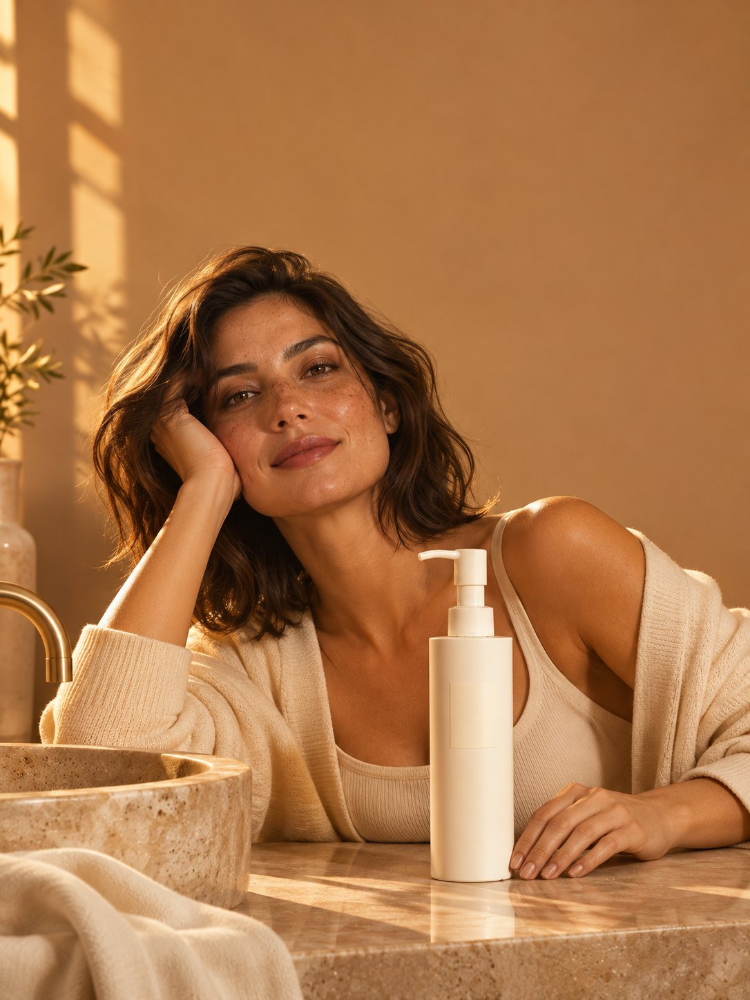

<details><summary>这一张的最终提示词</summary>

```text
Create one 3:4 vertical elevator-poster high-end beauty advertising photograph for a cleansing oil in a tall ivory cylindrical pump bottle, using Image 1 only as the user's product appearance reference, with its ivory pump, curved dispensing spout and subtle blank rectangular label.
Set it in a warm sand-coloured bathroom at home just after work, with the last golden evening sunlight coming through the window, natural stone at the washbasin, soft cream fabric and architectural shadows, feeling like a luxury cosmetics campaign: warm, relaxed, refined.
The model is a fictional synthetic adult woman about 28 years old, with shoulder-length dark brown hair, warm medium skin tone, brown eyes, relaxed eyebrows and natural freckles, strikingly beautiful.
Compose it with her leaning comfortably beside the washbasin in cream loungewear, seen from the waist up, her face and the single ivory pump bottle standing on the counter beside her resting hand forming the shared visual focus, keeping a generous clear upper quarter of warm sand wall as open scene space for logo and headline, without shrinking the beauty result.
Show her natural freckled complexion and understated end-of-day makeup before cleansing as the hero look; make its warm skin tones and softly luminous natural finish rich and unmistakable, the product held by her or in the foreground, in elegant unbranded packaging.
Real skin texture, crisp detail. No logos, brand names, monograms or readable text; no extra products, collage or variations.
```

</details>

### 第 2 张：电商详情页首图 1:1

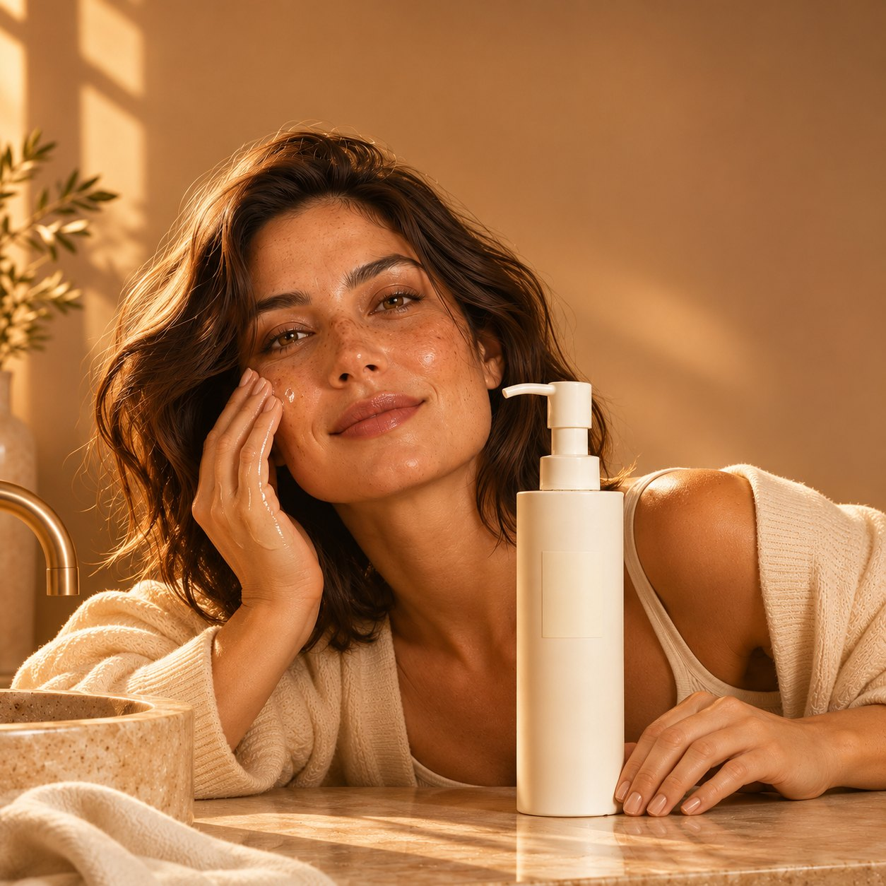

<details><summary>这一张的最终提示词</summary>

```text
Image 1 is the identity reference for the model.
Create one 1:1 square high-end beauty advertising photograph for cleansing oil in a tall ivory cylindrical pump bottle with an ivory left-facing curved spout and a subtle blank rectangular label, using Image 2 as the product appearance reference only.
Set it in a warm sand-coloured bathroom at home just after work, with the last golden evening sunlight entering through the window onto a natural stone vanity, cream textiles and architectural shadows, feeling like a luxury cosmetics campaign: warm, relaxed, refined.
The model is the same fictional adult woman represented in Image 1, approximately 28 years old, with shoulder-length dark brown hair, warm medium skin, brown eyes, relaxed brows and natural freckles, strikingly beautiful.
Compose it with her upper body in cream loungewear leaning close to the vanity, her face beside the upright foreground bottle and close to its visual plane so that both her face and the entire bottle are clearly sharp, prominent and easy to read together in an ecommerce detail-page hero image, keeping a modest area of warm wall and soft shadow at the top for logo and headline, without shrinking the beauty result.
Show naturally luminous skin in a relaxed end-of-day cleansing ritual as the hero look; make its warm skin tones against the creamy ivory bottle rich and unmistakable, the product held by her or in the foreground, in elegant unbranded packaging.
Real skin texture, crisp detail. No logos, brand names, monograms or readable text; no extra products, collage or variations.
```

</details>

### 第 3 张：信息流一 4:5

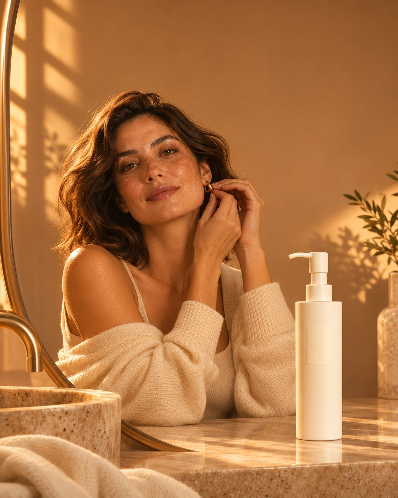

<details><summary>这一张的最终提示词</summary>

```text
Image 1 is the identity reference for the model.
Create one 4:5 vertical social-media-feed high-end beauty advertising photograph for a cleansing oil in an ivory cylindrical pump bottle, with Image 2 as product appearance reference only: tall straight-sided cream-white body, subtle blank rectangular label, stepped pump collar and curved dispensing spout.
Set it in a warm sand-coloured home bathroom just after coming home from work, with the last golden evening sunlight falling through the window onto natural stone, cream textiles and architectural shadows, feeling like a luxury cosmetics campaign: warm, relaxed, refined.
The model is the same fictional adult woman from Image 1, approximately 28, shoulder-length dark brown hair, warm medium skin tone, brown eyes, relaxed full brows and natural freckles, wearing a cream camisole and soft cream cardigan, strikingly beautiful.
Compose it with her seen from the waist up beside the bathroom mirror in the intimate moment of removing an earring, her hand at her ear and her face clearly visible, the single cleansing-oil pump bottle standing prominently on the stone countertop beside the mirror, keeping a little open warm wall and shadow space at the top for logo and headline, without shrinking the beauty result.
Show her natural freckled skin and softly luminous end-of-day beauty as the hero look; make its warm skin tones and subtle satin finish rich and unmistakable, the product held by her or in the foreground, in elegant unbranded packaging.
Real skin texture, crisp detail. No logos, brand names, monograms or readable text; no extra products, collage or variations.
```

</details>

### 第 4 张：信息流二 4:5

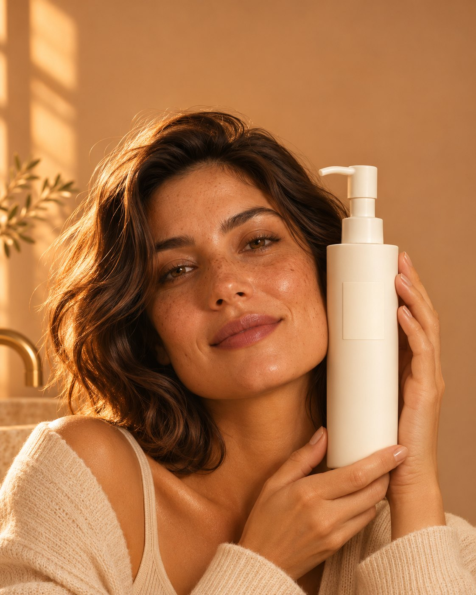

<details><summary>这一张的最终提示词</summary>

```text
Image 1 is the identity reference for the model.
Create one 4:5 vertical social-media-feed high-end beauty advertising photograph for a cleansing oil in an ivory cylindrical pump bottle, using Image 2 only as the product appearance reference: tall slender cream-white body, subtle blank rectangular label, stepped pump collar and curved pump spout, with no text.
Set it in a warm sand-coloured home bathroom just after returning from work at sunset, with the last golden window sunlight and soft spatial shadows, feeling like a luxury cosmetics campaign: warm, relaxed, intimate.
The model is the same fictional adult woman from Image 1, approximately 28 years old, with shoulder-length dark brown hair, warm medium skin, brown eyes, relaxed brows and natural freckles, strikingly beautiful.
Compose it with a simple intimate head-and-shoulders close-up, wearing cream-coloured homewear and holding the single pump bottle close beside her face so that her face and the entire bottle are clearly visible together, keeping a little soft warm wall space at the top for logo and headline, without shrinking the beauty result.
Show naturally textured warm skin and the intimate end-of-day cleansing ritual as the hero look; make the contrast of luminous warm skin and the milky ivory bottle rich and unmistakable, the product held by her or in the foreground, in elegant unbranded packaging.
Real skin texture, crisp detail. No logos, brand names, monograms or readable text; no extra products, collage or variations.
```

</details>

## 7. 方向三｜留白浴室

### 第 1 张：电梯海报 3:4

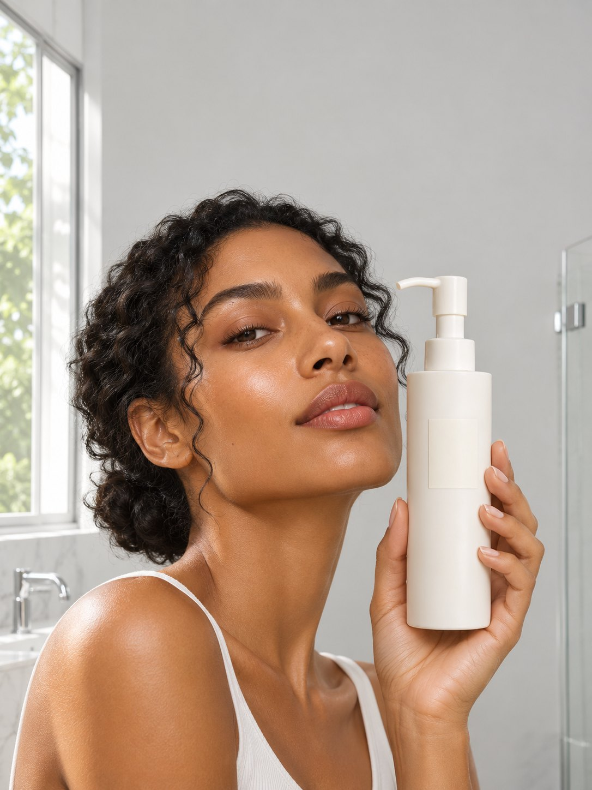

<details><summary>这一张的最终提示词</summary>

```text
Create one 3:4 vertical elevator-poster high-end beauty advertising photograph for a cleansing oil in an opaque milky-white tall cylindrical pump bottle, with a gently rounded base, a stepped cylindrical pump collar, a curved horizontal nozzle and a subtle blank rectangular label; Image 1 is the user's product appearance reference only.
Set it in a contemporary bathroom on a bright quiet morning, illuminated by daylight through its bathroom window, with milk-white and pale-grey walls, restrained clear glass and silver details, feeling like a luxury cosmetics campaign: bright, minimal, refined.
The model is a fictional adult woman aged approximately 25, with deep honey skin, black curly hair neatly gathered into a low bun, dark brown eyes and full lips, wearing a simple white tank top, strikingly beautiful.
Compose it with a distinctive close-up portrait of her face, neck and shoulders, holding the milky-white pump bottle beside her face with the bottle clearly visible and a natural face-to-bottle scale, keeping open pale-grey bathroom wall space at the top for logo and headline, without shrinking the beauty result.
Show fresh natural-looking skin and the sculptural relationship between her face, shoulders and the cleansing-oil bottle as the hero look; make its authentic skin texture and warm deep-honey tone against the milk-white and pale-grey bathroom palette rich and unmistakable, the product held by her or in the foreground, in elegant unbranded packaging.
Real skin texture, crisp detail. No logos, brand names, monograms or readable text; no extra products, collage or variations.
```

</details>

### 第 2 张：电商详情页首图 1:1

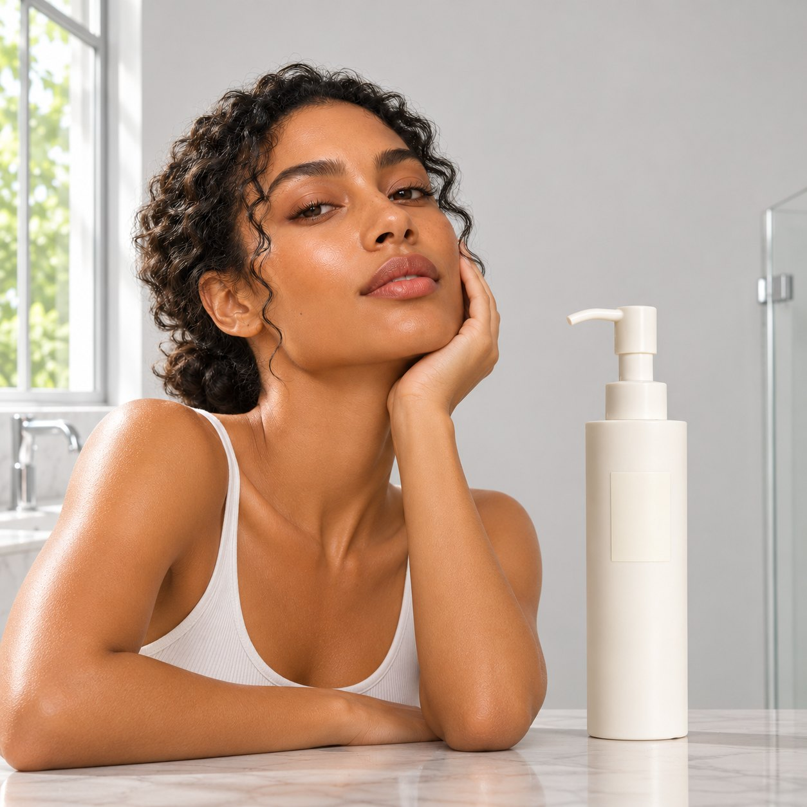

<details><summary>这一张的最终提示词</summary>

```text
Image 1 is the identity reference for the model.
Create one 1:1 square high-end beauty advertising photograph for a cleansing oil in a tall ivory cylindrical pump bottle with a stepped collar, left-facing curved pump spout and a blank rectangular label, using Image 2 as the product appearance reference only.
Set it in a contemporary milk-white and pale-grey bathroom in a bright daytime moment with natural window light, subtle clear glass and silver architectural details, feeling like a luxury cosmetics campaign: bright, minimal, refined.
The model is the same fictional adult woman from Image 1, approximately 25 years old, with deep honey skin, black curly hair gathered into a neat low bun, dark brown eyes, full lips and a simple white tank top, strikingly beautiful.
Compose it with her face, shoulders and upper torso beside the product in a balanced side-by-side composition, the single bottle standing upright on the bathroom counter in the foreground and visible in full from the top of its pump to its base with comfortable frame margins, her face and the entire bottle both crisp and clearly readable, a pale-grey wall behind the ivory bottle separating its edges, keeping modest open pale-grey wall space at the top for logo and headline, without shrinking the beauty result.
Show her natural fresh beauty and realistic skin texture as the hero look; make its understated luminous finish rich and unmistakable, the product held by her or in the foreground, in elegant unbranded packaging.
Real skin texture, crisp detail. No logos, brand names, monograms or readable text; no extra products, collage or variations.
```

</details>

### 第 3 张：信息流一 4:5

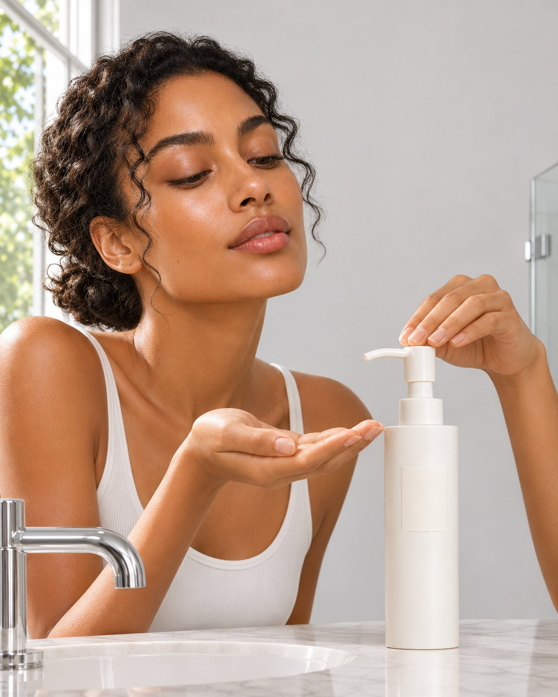

<details><summary>这一张的最终提示词</summary>

```text
Image 1 is the identity reference for the model.
Create one 4:5 vertical high-end beauty advertising photograph for a cleansing oil in a tall milk-white cylindrical pump bottle, with Image 2 used only as the product appearance reference for the plain bottle, stepped pump collar, curved spout and blank rectangular label.
Set it in a contemporary milk-white and pale-grey bathroom at the washbasin at the start of a morning cleansing ritual, illuminated by natural window daylight, with restrained clear glass and silver fittings, feeling like a luxury cosmetics campaign: bright, minimal, refined.
The model is a fictional adult woman around 25, recognizably consistent with Image 1, with deep honey skin, black curly hair gathered into a low bun, dark brown eyes, full lips and naturally full eyebrows, strikingly beautiful.
Compose it with her upper body in a simple white tank top at the washbasin, her face and both hands visible as she looks toward the action and presses the pump head with one hand while holding the other palm beneath the spout of the complete upright bottle on the counter, capturing the instant the press begins before any liquid emerges, keeping clean pale-grey wall space above and beside her for logo and headline, without shrinking the beauty result.
Show her natural luminous skin and the clear beginning-of-cleansing pump action, with no dispensed liquid, droplets, foam or invented product texture, as the hero look; make its warm skin tones and true skin texture against the milk-white and pale-grey bathroom rich and unmistakable, the product held by her or in the foreground, in elegant unbranded packaging.
Real skin texture, crisp detail. No logos, brand names, monograms or readable text; no extra products, collage or variations.
```

</details>

### 第 4 张：信息流二 4:5

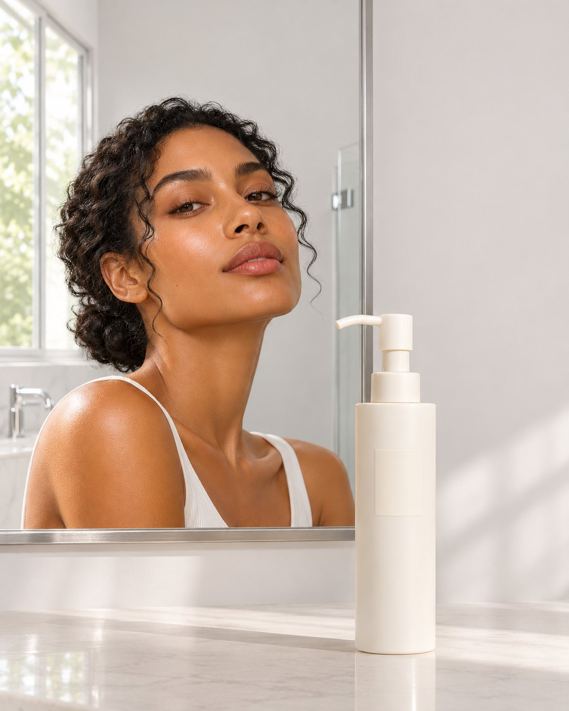

<details><summary>这一张的最终提示词</summary>

```text
Image 1 is the identity reference for the model.
Create one 4:5 portrait high-end beauty advertising photograph for a cleansing oil in an ivory cylindrical pump bottle, with Image 2 used only as the product appearance reference for its tall straight body, stepped pump collar, curved dispensing spout and plain blank rectangular label.
Set it in a contemporary milk-white and pale-gray bathroom on a bright morning with natural window daylight, a pale countertop, a large geometric mirror, restrained clear glass and silver metal details, feeling like a luxury cosmetics campaign: bright, minimal, refined.
The model is the same fictional adult woman from Image 1, approximately 25 years old, deep honey skin, black curly hair gathered into a neat low bun with delicate face-framing curls, deep brown eyes, full lips and strong natural eyebrows, wearing a simple white tank top, strikingly beautiful.
Compose it with her face, neck and upper shoulders seen as a portrait inside the bathroom mirror, and the single complete physical pump bottle standing upright on the countertop in the foreground, creating an elegant visual dialogue between reflected portrait and tangible product through the mirror's clean rectangular geometry, believable spatial relationships and generous asymmetrical negative space, keeping an uncluttered area of milk-white or pale-gray wall at the top and side for logo and headline, without shrinking the beauty result.
Show naturally luminous skin with visible pores and subtle fresh beauty styling as the hero look; make its warm honey tone and softly dewy finish rich and unmistakable, the product held by her or in the foreground, in elegant unbranded packaging.
Real skin texture, crisp detail. No logos, brand names, monograms or readable text; no extra products, collage or variations.
```

</details>

## 如实说明

- 每个方向只出了这 4 张；同一方向里的 4 张由作者判为同一位模特，三个方向是三位不同的模特。
- 产品外观：12 张都还原了照片里的乳白圆柱瓶身和弯嘴泵头，空白贴标也在。
- 模特是虚构的合成成年人；方向一的雀斑是 Skill 在方向里自己写的，需求没有要求。
- 每次运行的结果会不同；用于商业投放前，请逐张检查手、镜面与反射、产品结构，以及包装上是否出现类似真实品牌的标志。
