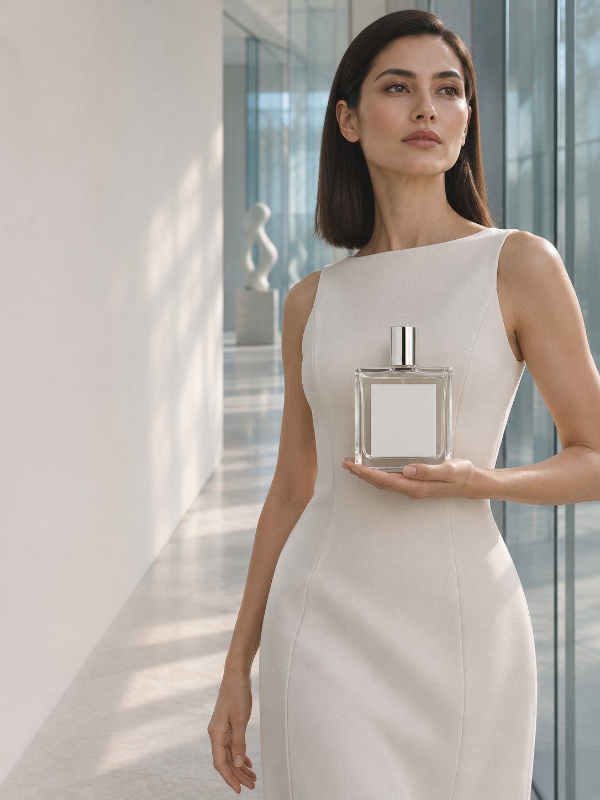
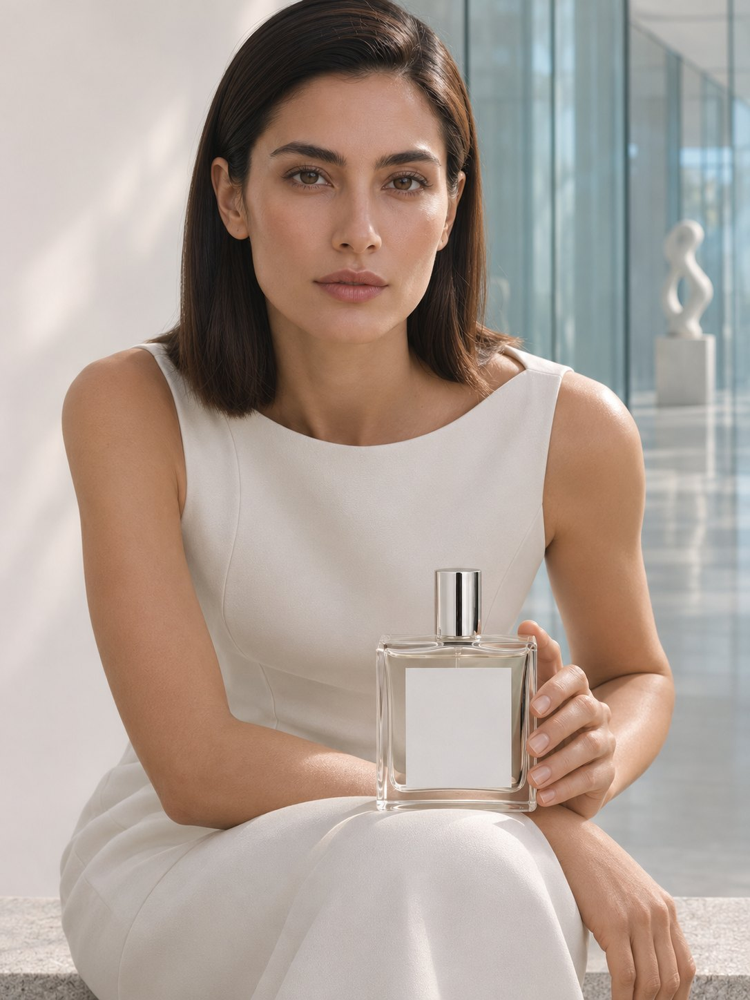
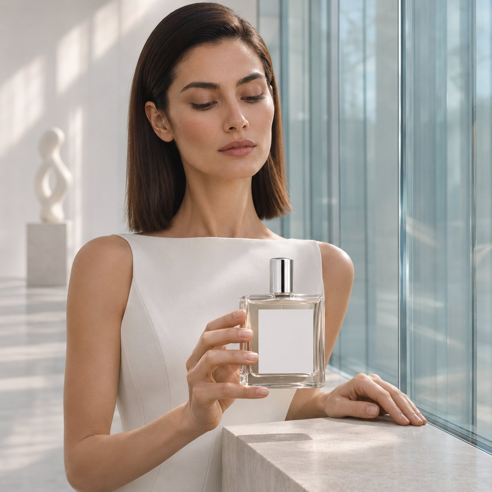
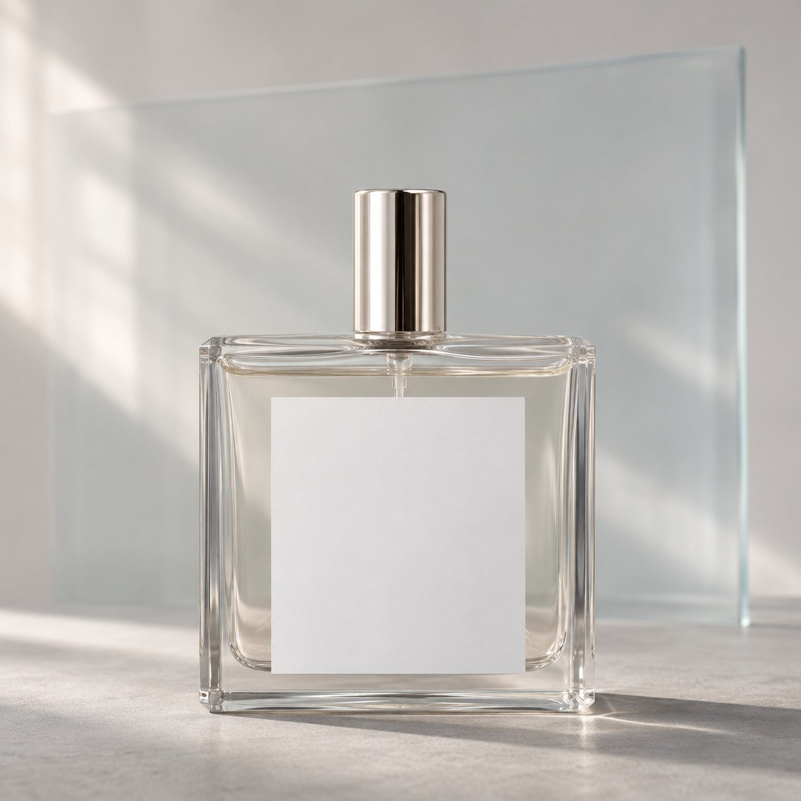
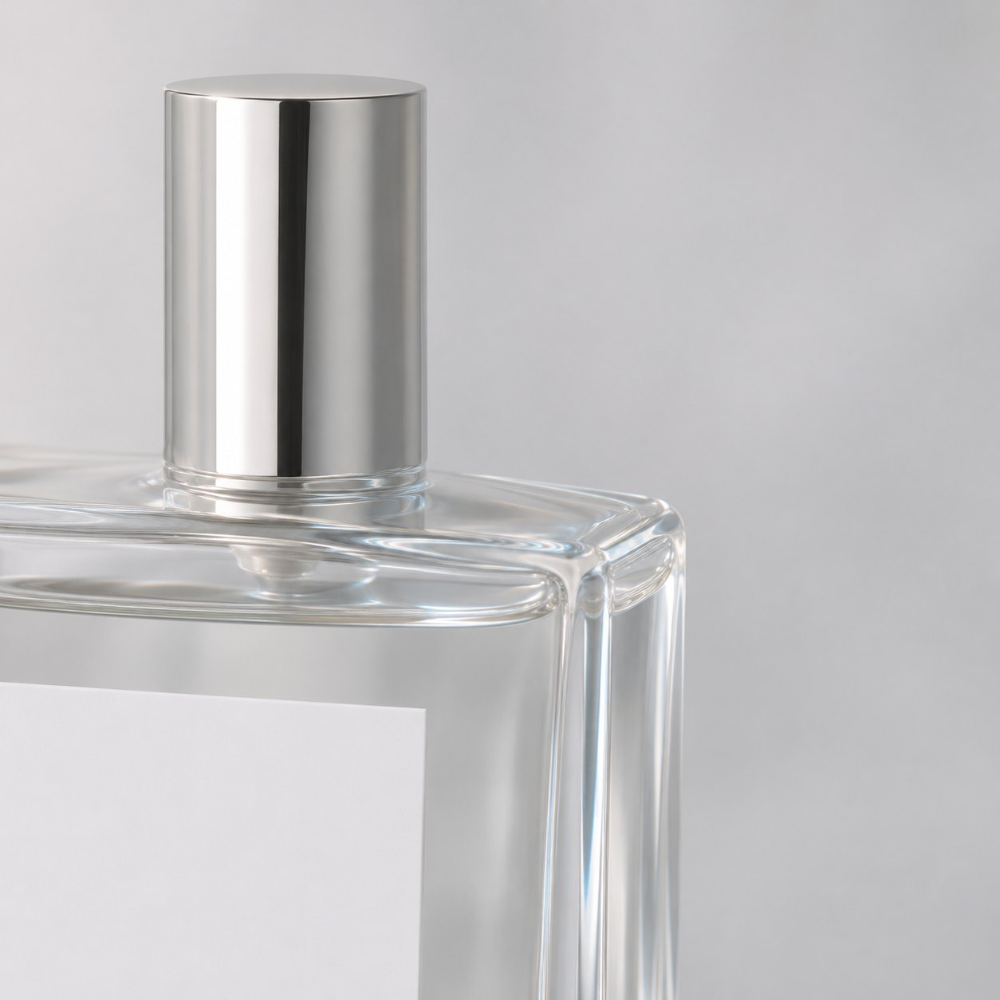
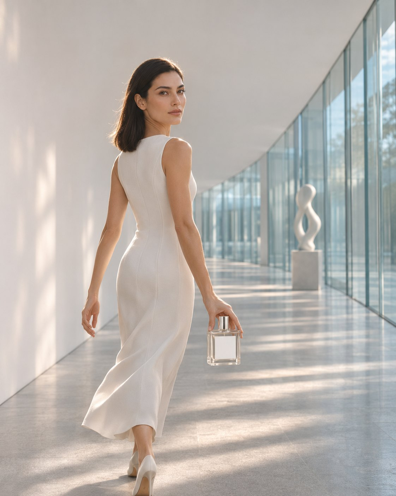
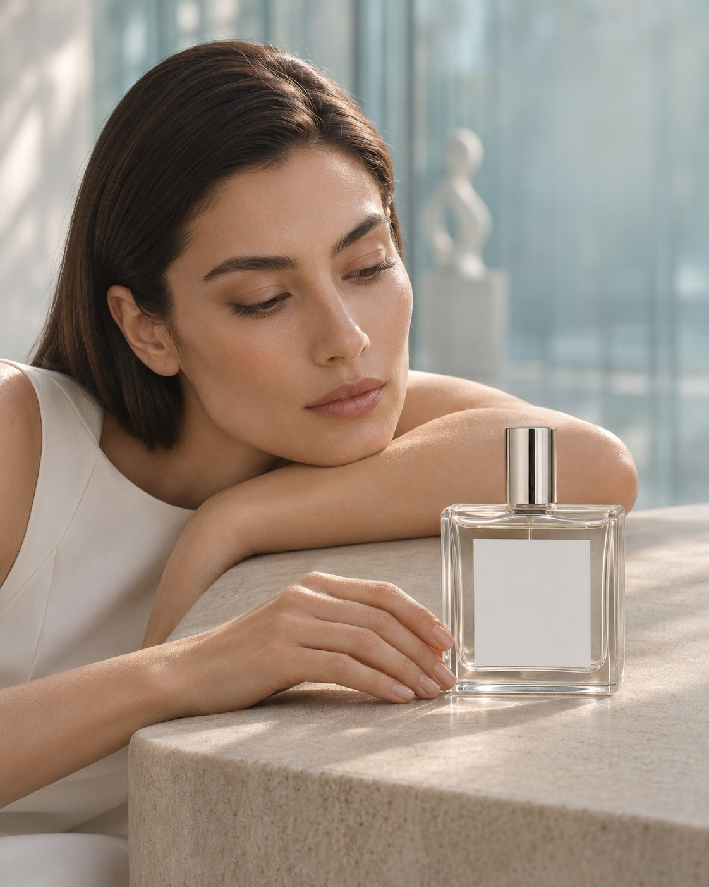

# 案例：香水 · 光的收藏 · 7 张全套组图

和[海岸留白](fragrance-seaside-full-set.md)是同一个需求、同一张产品照片、同一次方向输出，这里选的是 Skill 给出的方向三。用 v0.1.4 Skill 在 Codex 里跑：用户把方向三原文和 7 张分工发回、要求带模特的几张不要都把瓶子举在脸旁 → Skill 写出逐张方案 → 先出第 1 张；用户觉得模特一般，请 Skill 只重写模特设定，再出第 1 张，确认人物后以它作为身份参考出其余带模特的镜头；静物只附产品照片。下面的需求、方案、模特设定、提示词与成图都是原样输出。

## 1. 产品照片与最初的需求

与海岸留白案例相同：透明方形玻璃瓶、银色圆柱瓶盖、白色空白标签，没有品牌字样，瓶底被沙挡住；照片来自 Pexels 免费图库（https://www.pexels.com/photo/clear-glass-perfume-bottle-with-silver-cap-8361540/ ），不随本仓库发布。最初的需求原话和 Skill 给出的 3 个方向见[海岸留白案例第 2、3 节](fragrance-seaside-full-set.md)。

## 2. 选方向三，并请 Skill 细化（原话，附上产品照片）

> 这是我的香水，附图是产品照片。请为它做一套新品上市的广告大片全套组图，以带模特为主，用于电梯海报（3:4）、电商详情页（1:1）和社交媒体信息流（4:5），面向 25–38 岁女性。我从你给的方向里选了方向三：
>
> **方向三｜光的收藏**
> *关键词：艺术、清透、现代雕塑感*
>
> 从方形玻璃瓶本身出发，把光线、建筑与人物组织成简洁而醒目的画面。主色是骨白、浅灰与冰蓝，材质使用半透明玻璃、浅色石材和挺括织物。
>
> 主视觉发生在午后的现代美术馆连廊：一位约 28 岁的虚构成年女性，黑色长直发收于耳后、中等暖棕肤色、深棕眼睛、修长眼型，穿结构简洁的白色无袖连衣裙。她在玻璃隔断旁停步，手持香水于胸前；人物、方瓶和建筑线条形成清晰构图，一侧白墙用于后续排版。
>
> 组图延伸到玻璃旁的人物近景、行走中的回望、手与瓶身的几何构图，以及展示瓶身边缘和银盖反光的静物。画面有艺术感，也能让产品的外观成为记忆点。
>
> **适合：**希望建立更鲜明的现代设计气质，让新品在信息流中具有辨识度。
>
> 按你建议的 7 张分工：
>
> | 张数 | 用途与比例 | 每张承担的任务 |
> |---|---|---|
> | 1 | 电梯海报 · 3:4 | 模特＋产品主视觉，远看先识别人和香水，预留标题区 |
> | 2 | 电梯海报 · 3:4 | 更紧凑的模特半身构图，突出面部情绪与瓶身 |
> | 3 | 电商详情页 · 1:1 | 模特持香近景，展示瓶身尺寸感与使用情境 |
> | 4 | 电商详情页 · 1:1 | 产品完整静物，让消费者看清整体外观 |
> | 5 | 电商详情页 · 1:1 | 产品细节静物，突出玻璃、银盖与材质关系 |
> | 6 | 社交信息流 · 4:5 | 有故事感的模特场景，建立生活联想 |
> | 7 | 社交信息流 · 4:5 | 模特与香水的亲密近景，强化情绪记忆 |
>
> 请把这 7 张细化成逐张方案。5 张模特图不要都把瓶子举在脸旁或颈侧，每张换一个不同的时刻。这一步只要文字，不要生成任何图片。

## 3. Skill 写出的 7 张逐张方案（原文）

方案里的模特描述（约 28 岁、暖棕肤色）后来被第 4 节的新设定取代。

> 这套「光的收藏」以**同一位女性在美术馆停留的一个下午**串联七张画面。五张模特图分别捕捉：**停步、落座、取香、回望、俯身凝视**，让产品随人物的动作自然出现，每张都有不同的观看理由。
>
> 全组保持骨白、浅灰、冰蓝的环境色，保留模特中等暖棕肤色的温度。冰蓝主要来自玻璃与背景反射，不把皮肤染蓝。光线统一为午后侧光，形成清楚但不过硬的建筑投影；服装使用挺括、哑光的白色无袖连衣裙，避免与玻璃和银盖争夺高光。
>
> 模特沿用你选定的约 28 岁虚构成年女性：黑色长直发收于耳后、深棕眼睛、修长眼型，补充清晰而柔和的下颌线作为辨识特征。妆面自然细腻，眼唇低饱和，不用醒目首饰。
>
> 产品以附图可见外观为依据：**近方形透明玻璃瓶、圆柱形银色盖、大面积白色正面标签**。照片无法确认容量与实际尺寸，下面不设定具体毫升数；瓶身与手部的相对尺度需全组统一。香调及功效尚未提供，因此不加入花材、果实或暗示功效的视觉元素。
>
> 1. **电梯主海报｜停在光里｜3:4**
>
>    **任务：**建立整套广告的第一记忆点，让人先看到女性、方瓶与建筑线条的关系。
>
>    **时刻与动作：**她刚走到玻璃隔断旁，身体停住，肩膀仍保留轻微转向。香水竖直持于胸骨下方，一只手托住瓶底，另一只手自然垂落。目光越过镜头，像被连廊另一端的一件作品吸引。
>
>    **构图：**采用膝上中景，人物位于右侧约六成区域；左侧保留连续的骨白墙面。瓶身处在白裙前方，与人物一起形成明确轮廓。玻璃竖线、瓶身边线和裙装结构相互呼应，避免建筑线穿过脸部。
>
>    **光线与产品：**侧光照亮脸颊与玻璃瓶一侧，利用较暗的玻璃背景和受控反射勾出透明瓶边。标签朝向镜头，手指不遮住主要正面；银盖保留一条干净的亮面。
>
>    **排版：**左上至左中预留约三成宽度的标题区，下方留品牌与上市信息的位置。缩小预览时，必须仍能分辨瓶身轮廓，不能让香水变成胸前一个模糊亮点。
>
> 2. **电梯辅助海报｜落座的一刻｜3:4**
>
>    **任务：**比主海报更靠近人物，突出面部情绪，同时让瓶身保持清楚可见。
>
>    **时刻与动作：**她坐在连廊的浅灰石凳边缘，身体略向前，抬眼看向镜头。前臂自然落在大腿上，香水直立于膝上，由一只手轻扶。表情平静、有交流感，不做明显笑容。
>
>    **构图：**从头顶到大腿上段的紧凑坐姿半身构图。脸位于上半部，瓶身位于下方偏中位置，两者形成短而明确的斜线。石凳只露出一条水平边，与第一张的竖向建筑构图形成变化。
>
>    **光线与产品：**面部接受柔和侧光，背景玻璃呈浅冰蓝。膝上的白色织物成为瓶身底衬，通过瓶体一侧的暗边维持透明感；手指落在瓶侧，露出完整银盖与大部分标签。
>
>    **排版：**左上保留小块干净墙面，适合一句短标题；不在脸与瓶之间插入文案，保持两者的视觉联系。
>
> 3. **电商持香近景｜从台面取起｜1:1**
>
>    **任务：**展示手与瓶的尺度关系，以及日常拿取产品的自然情境。
>
>    **时刻与动作：**她站在玻璃隔断旁，从窄石台上拿起香水。定格在瓶底刚离开台面的瞬间，手指握住瓶身两侧，另一只手轻搭台沿。她低头看向手中的香水。
>
>    **构图：**方形画面裁至头部与腰际之间，人物略偏左，产品位于中下部、接近画面中心。石台横线与瓶体竖线组成清晰几何结构；保留足够面部信息，使它仍是一张人物广告近景。
>
>    **光线与产品：**用大面积柔光呈现肤质，玻璃边缘带少量冰蓝反射。瓶身正面略转向镜头，清楚展示瓶肩、盖体与标签关系。手掌与产品处于接近的景深范围，避免手清楚、瓶身却虚掉。
>
>    **页面衔接：**画面不承担大标题，四边保持简洁，便于详情页在图片上下配置介绍文字。此张呈现“拿取”，不加入喷雾、开盖或未确认的使用结构。
>
> 4. **电商完整静物｜一件透明的藏品｜1:1**
>
>    **任务：**让消费者完整看清产品整体外观，承担全组最直接的商品展示职责。
>
>    **场景与摆放：**单瓶竖直放在哑光浅灰石台上，背景是一块与产品拉开距离的半透明玻璃。瓶身接近正面，仅轻微转动，露出少量侧面厚度。
>
>    **构图：**产品居中略偏下，瓶盖、瓶底与左右边缘全部入画；整体约占画面高度的三分之二。台面只保留必要面积，不摆多余装饰，不用玻璃倒影制造第二只瓶子的错觉。
>
>    **光线与产品：**柔和透射光表现瓶体透明度，侧面暗部勾勒玻璃厚度。银盖出现有层次的明暗渐变，标签保持中性白色，避免整片高光覆盖正面。
>
>    **页面衔接：**上方保留少量呼吸空间，可与详情页标题区连接。此张优先保证清晰、自然的外观识别，冰蓝只作为轻微背景色。
>
> 5. **电商细节静物｜光经过边缘｜1:1**
>
>    **任务：**放大玻璃边缘、瓶肩与银盖之间的材质差异。
>
>    **场景与摆放：**产品继续直立，背景改为更均匀的浅灰。用近距离侧前方视角，聚焦银盖、瓶肩和一侧竖直玻璃边。
>
>    **构图：**完整银盖留在画面上部，瓶身下部有意识地出画；保留一角白色标签作为识别线索。通过偏置构图形成大小不同的留白，不把瓶体旋转成难以辨认的抽象形状。
>
>    **光线与产品：**银盖上呈现一道长条反光和相邻的灰色过渡，玻璃边缘出现细而清楚的折射亮线。重点区域清晰，背景柔化；不增加水珠、冰霜或并不存在的材质纹理。
>
>    **页面衔接：**适合搭配外观与设计说明。瓶肩、银盖和玻璃边缘构成一个连续细节，避免用过浅景深只留下无意义的亮点。
>
> 6. **社交场景图｜走过之后，回头｜4:5**
>
>    **任务：**给新品一个可代入的生活片段，增加流动感与故事性。
>
>    **时刻与动作：**她正沿玻璃连廊离开，身体保持行走方向，头部轻轻回望。持香的手自然垂在身侧、略离开裙摆，另一只手随步伐放松摆动。裙摆有轻微运动，人物与瓶身保持清晰。
>
>    **构图：**取小腿以上的环境人像，人物位于画面中左侧，右侧展开连廊纵深。地面的光带引向她；香水落在下半部的干净背景前，避免藏在腿后或与裙摆重叠。
>
>    **光线与产品：**带有方向性的午后侧逆光擦亮发丝与肩部，同时给面部适量补光。瓶身以略带侧面的角度出现，仍能辨认近方形轮廓与银盖；握持位置避开主要标签区域。
>
>    **信息流使用：**上方保留一句短文案的空间，脸与产品均避开画面边缘。此张的视觉顺序是“回望的人—连廊空间—手中的香水”，让产品成为这个下午的一部分。
>
> 7. **社交情绪近景｜靠近一束光｜4:5**
>
>    **任务：**以安静、私密的观察强化情绪记忆，同时区别于常见的贴脸持瓶姿势。
>
>    **时刻与动作：**她坐在浅色石桌旁，身体微微前倾，脸颊轻靠在交叠的前臂上，目光落向桌上的香水。瓶子直立在手边，另一只手的指尖轻触瓶底一侧，像在观察光穿过玻璃。
>
>    **构图：**近景纳入完整面部、肩部、前臂与完整瓶身。脸位于上半部偏左，香水位于下半部偏右，中间留出一小段可见桌面；瓶子与脸尽量处于接近的焦平面，避免前景瓶子被夸张放大。
>
>    **光线与产品：**柔光落在眼睛、手背和瓶肩上，背景仅留模糊的冰蓝玻璃色块。保留真实皮肤纹理与清楚的玻璃边缘；香水与面部之间有明确间隔，不贴脸、不抵住颈侧。
>
>    **信息流使用：**以影像本身为主，只在上方或角落留少量文字位置。它与第六张形成节奏变化：一张是行走中的回望，一张是停下来后的凝视。

## 4. 换模特

按方案出的第 1 张，用户觉得模特一般（这张不发布）。把方案原样发回，后面加了一句（原话）：

> 第 1 张出来了。这个模特一般，换一个模特。请只给出新的模特设定，其余 7 张方案不变。这一步只要文字，不要生成任何图片。

Skill 给出的新模特设定（原文）：

> **新模特设定｜清冷、知性，有雕塑感的女性**
>
> - **身份与年龄：**约 30 岁的虚构成年女性，气质成熟、从容，带有艺术从业者的敏锐与专注。
> - **脸部轮廓：**偏长的鹅蛋脸，颧骨略高，面颊线条利落，下颌收束柔和。辨识特征是**清晰的高颧骨与饱满、弧度柔和的唇形**，兼具力量感与女性柔美。
> - **眼睛与眉形：**深棕色杏仁眼，眼窝略深，眼尾平直；眉毛浓度自然、眉峰舒展。目光沉静而有穿透力，近景中有交流感。
> - **肤色与肤质：**中等橄榄肤色，带温暖的金色底调；保留细腻的真实皮肤纹理，在骨白与冰蓝环境中呈现自然温度。
> - **发型：**深黑棕色齐锁骨直发，利落齐切发尾、偏分，两侧收于耳后，露出颧骨、耳部与颈部线条。
> - **身形与仪态：**身形修长，肩颈舒展，肩线平直；姿态自然松弛，动作有轻盈的控制感。
> - **妆容与服装：**轻薄半哑光底妆，低饱和灰棕眼妆与柔和裸玫瑰唇色。沿用挺括、哑光的白色无袖连衣裙，不戴醒目首饰。
>
> **七张均沿用这位新模特，其余方案不变。**

## 5. 怎么出的图

- 出图时，方案里的旧模特描述删去，换成上面的新设定，其余方案原样不变。
- 第 1 张只附产品照片；用户确认人物后，第 2、3、6、7 张都附两张图——附图 1 是第 1 张（只作人物身份参考），附图 2 是产品照片；第 4、5 张是产品静物，只附产品照片。
- 每张在单独的会话里出，提示词由 Skill 按模板自己写（下面每张图下可展开）；每张只出 1 次（第 1 张换模特后重出 1 次），没有挑选、没有重抽、没有局部修补，发布时只转成 JPEG。

## 6. 成图

### 第 1 张：电梯海报 3:4



<details><summary>这一张的最终提示词</summary>

```text
Create one 3:4 vertical high-end beauty advertising photograph for a new perfume launch elevator poster, aimed at women aged 25–38, using Image 1 only as the product appearance reference: a near-square clear glass bottle, cylindrical polished silver cap, and a large plain white front label.
Set it in a modern art museum corridor in the afternoon, with natural side light illuminating her cheek and one edge of the glass bottle, clear but not harsh architectural shadows, translucent glass partitions, pale stone and a continuous bone-white wall, feeling like a luxury cosmetics campaign: artistic, crystalline, modern sculptural.
The model is a fictional adult woman around 30 with mature, composed intellectual presence, an elongated oval face, defined high cheekbones, clean cheek contours, softly tapering jaw, full softly curved lips, deep brown almond eyes with slightly deep sockets and straight outer corners, natural brows with gently extended arches, medium olive skin with warm golden undertones, dark black-brown straight collarbone-length hair with blunt ends and a side part tucked behind both ears, a slender figure with relaxed elongated neck and level shoulders, wearing a structured matte white sleeveless dress, subtle semi-matte makeup, muted taupe eyes and soft nude-rose lips, no conspicuous jewelry, strikingly beautiful.
Compose it with her framed from just above the knees to above her head in the right approximately 60 percent of the image, stopped beside a glass partition with her shoulders retaining a subtle turn from walking, her gaze passing just beyond the camera toward an unseen artwork down the corridor, one hand naturally supporting the upright perfume bottle from beneath just below her sternum in front of her white dress, its plain white label facing the camera and fingers leaving the main front clear, her other arm hanging naturally at her side, glass verticals and bottle edges echoing dress structure without architectural lines crossing her face, keeping a continuous uncluttered bone-white wall in the left approximately 30 percent from upper left through middle left and additional open wall below for logo and headline, without shrinking the beauty result.
Show the relationship between the woman, the unmistakable square transparent perfume bottle and the architectural lines as the hero look; make its clear glass edges and cylindrical silver cap with one clean controlled bright reflection rich and unmistakable, the product held by her or in the foreground, in elegant unbranded packaging, at a believable palm-supported scale and large and sharply resolved enough for its square silhouette to remain recognizable in a thumbnail, with controlled darker reflections defining the bottle against the white dress and the darker glass partition helping separate the silhouette, a bone-white, pale gray and ice-blue environmental palette with ice blue restricted to glass and background reflections while skin stays naturally warm.
Real skin texture, crisp detail. No logos, brand names, monograms or readable text; no extra products, collage or variations.
```

</details>

### 第 2 张：电梯海报 3:4



<details><summary>这一张的最终提示词</summary>

```text
Image 1 is the identity reference for the model.
Create one 3:4 vertical high-end beauty advertising photograph for a perfume in a near-square transparent glass bottle with a cylindrical polished silver cap and a large blank white front label, using Image 2 only as the product appearance reference.
Set it in a modern art museum corridor during the same afternoon as Image 1, beside pale ice-blue glass partitions and a bone-white wall, with a pale grey stone bench and soft afternoon sidelight on her face, feeling like a luxury cosmetics campaign: artistic, translucent, sculptural.
The model is the same fictional adult woman from Image 1, around 30, with straight dark black-brown collarbone-length hair, blunt ends and a side part tucked behind her ears, warm golden medium olive skin, deep brown almond eyes, a long oval face with defined high cheekbones and full softly curved lips, strikingly beautiful.
Compose it with her sitting at the edge of the stone bench, leaning slightly forward and raising her eyes to look directly into the camera with a calm, engaged expression and no obvious smile, wearing the same structured matte white sleeveless dress with no conspicuous jewelry; frame tightly from above the top of her head to her upper thighs, her forearms resting naturally on her thighs, a single perfume bottle standing upright on her knee and gently steadied by one hand with fingers along the bottle side; her face in the upper half and bottle lower near center form a short clear diagonal, with just a horizontal strip of the stone bench visible, keeping a small clean patch of bone-white wall in the upper left for logo and headline, without shrinking the beauty result.
Show her softly semi-matte natural complexion, understated grey-brown eye makeup and nude rose lips alongside the clearly visible transparent perfume bottle as the hero look; make its clear glass edges, silver cap reflections and large blank white label rich and unmistakable, the product held by her or in the foreground, in elegant unbranded packaging, retaining the bottle-to-hand relative scale from Image 1, the white dress under the bottle revealing its transparency with a dark reflective edge on one side, the complete silver cap and most of the label unobstructed, bone-white, pale grey and ice-blue surroundings while her skin stays warm, with nothing inserted between her face and the bottle.
Real skin texture, crisp detail. No logos, brand names, monograms or readable text; no extra products, collage or variations.
```

</details>

### 第 3 张：电商详情页 1:1



<details><summary>这一张的最终提示词</summary>

```text
Image 1 is the identity reference for the model. Image 2 is the product appearance reference only.
Create one 1:1 square high-end beauty advertising photograph for a perfume in a near-square transparent glass bottle with a cylindrical polished silver cap and a large blank white front label, matching the visible appearance in Image 2 and the hand-to-bottle scale in Image 1.
Set it in a modern art museum corridor beside a glass partition and a narrow pale stone ledge, during the same afternoon as the approved campaign portrait, with broad soft afternoon side light, subtle architectural shadows and small ice-blue reflections along glass edges, feeling like a luxury cosmetics campaign: artistic, translucent, sculptural.
The model is the same fictional adult woman around 30 seen in Image 1, with an elongated oval face, defined high cheekbones, softly full curved lips, deep brown almond eyes, naturally full brows, warm medium olive skin with golden undertones, dark black-brown straight side-parted hair with blunt ends tucked behind her ears, refined long neck and relaxed shoulders, wearing the same structured matte white sleeveless dress, sheer semi-matte makeup, muted taupe eyes and nude rose lips, no conspicuous jewelry, strikingly beautiful.
Compose it with her slightly left of center, framed from her complete head to her waist, retaining clearly recognizable facial features as she lowers her gaze to the perfume; capture the exact moment she lifts the bottle off the narrow stone ledge with a small visible gap beneath its base, one hand naturally gripping the two sides of the glass bottle rather than the cap, the other hand resting lightly on the ledge; the bottle is in the lower middle near the image center, its front angled slightly toward the camera to show the shoulders, silver cap and blank label clearly; the stone ledge horizontal and bottle vertical create clean geometry, keeping simple uncluttered margins on all four sides for surrounding ecommerce layout, with no in-image headline or text.
Show the beautiful glass perfume bottle and the natural relationship between her hand and its scale as the hero look; make its transparent glass edges, silver reflections and blank white label rich and unmistakable, the product held by her in elegant unbranded packaging, with her hand and the bottle both sharply resolved in a similar depth of field, her facial skin naturally textured and warm without blue tint, surrounded by bone white, light gray and ice blue glass and pale stone; keep the cap on, without spray, opening, flowers, fruit or ingredient cues.
Real skin texture, crisp detail. No logos, brand names, monograms or readable text; no extra products, collage or variations.
```

</details>

### 第 4 张：电商详情页 1:1（产品静物）



<details><summary>这一张的最终提示词</summary>

```text
Create one 1:1 square high-end beauty advertising photograph for a perfume, the complete e-commerce still life titled conceptually “A transparent collectible” in the “Collection of Light” campaign, using Image 1 only as the user's product appearance reference: a near-square clear glass bottle with a substantial transparent glass perimeter, a tall cylindrical polished silver cap and a large plain neutral-white front label, preserving the visible proportions without inventing capacity or text.
Set it in a minimalist modern art museum display setting on a matte pale-grey stone tabletop in the afternoon, with a single translucent glass panel well behind the bottle and softly transmitted afternoon side light, feeling like a luxury cosmetics campaign: artistic, lucid, sculptural.
Compose it with a single bottle standing vertically, centered slightly below the middle, almost front-facing with only a very slight rotation revealing a little side thickness, the whole product occupying approximately two thirds of the square image height and the cap, base and both side edges entirely inside the frame, keeping a small area of quiet background above for logo and headline, without shrinking the beauty result.
Show the complete and clearly recognizable perfume exterior as the hero look; make its glass transparency and thickness, controlled darker side edges, nuanced bright-to-dark silver-cap reflections and neutral white matte label rich and unmistakable, the product in the foreground, in elegant unbranded packaging, with bone white and pale grey surroundings and only a faint ice-blue cast in the distant glass background, minimal tabletop visible, a natural contact shadow, no broad glare obscuring the label, no decorative props and no mirror image suggesting a second bottle.
Real skin texture, crisp detail. No logos, brand names, monograms or readable text; no extra products, collage or variations.
```

</details>

### 第 5 张：电商详情页 1:1（产品细节静物）



<details><summary>这一张的最终提示词</summary>

```text
Create one 1:1 square high-end beauty advertising photograph for a perfume in a near-square transparent glass bottle with a cylindrical polished silver cap and a large blank white front label, using attached Image 1 as product appearance reference only.
Set it in a uniformly light-gray still-life setting for the fifth detail image of the “Collection of Light” campaign, with afternoon side light, bone-white and pale gray tones and very subtle ice-blue reflections in the glass, feeling like a luxury cosmetics campaign: artistic, translucent, sculptural.
Compose it with a single upright bottle in an off-center close-up viewed from slightly to the front and side, the complete cylindrical silver cap visible with generous safety margin in the upper part of the square, the shoulder and one vertical glass edge forming a continuous readable detail, the lower bottle intentionally extending beyond the bottom frame and only a corner of the blank white label visible, keeping unequal areas of softly blurred light-gray background at the sides for logo and headline, without shrinking the beauty result.
Show the contrast between the smooth polished silver cap, transparent glass shoulder and thick vertical glass edge as the hero look; make a single elongated strip reflection with an adjacent soft gray tonal transition on the cap, and a fine clean refracted highlight along the glass edge rich and unmistakable, the product in the foreground, in elegant unbranded packaging; keep the cap, shoulder and glass edge crisply resolved together with sufficient depth of field, preserve the recognizable upright near-square bottle architecture from Image 1, no extreme rotation, no droplets, no frost, no invented surface texture, no sand, no extra props.
Real skin texture, crisp detail. No logos, brand names, monograms or readable text; no extra products, collage or variations.
```

</details>

### 第 6 张：信息流 4:5



<details><summary>这一张的最终提示词</summary>

```text
Image 1 is the identity reference for the model.
Create one 4:5 vertical high-end beauty advertising photograph for a perfume with a near-square clear glass bottle, cylindrical polished silver cap and large blank white front label, using Image 2 for product appearance only.
Set it in a modern art museum glass corridor in the afternoon, with bone-white walls, pale gray stone floor, translucent glass and ice-blue architectural reflections, directional afternoon side-backlight grazing her hair and shoulders and gentle reflected fill on her face, clear yet softly edged bands of sunlight on the floor leading toward her, feeling like a luxury cosmetics campaign: artistic, lucid, sculptural.
The model is the same fictional adult woman seen in Image 1, approximately 30, with a long oval face, defined high cheekbones, full softly curved lips, deep brown almond eyes, natural brows, warm golden medium olive skin and dark brown-black straight collarbone-length hair with a side part tucked behind her ears, wearing the same structured matte white sleeveless dress, subtle semi-matte makeup, muted taupe eyes and nude rose lips, no conspicuous jewelry, strikingly beautiful.
Compose it with her at center-left in an environmental portrait framed from above her head to her lower calves, her body continuing to walk away along the corridor while her head turns gently back toward the camera with a calm engaging gaze, her perfume-holding arm hanging naturally beside her and slightly away from the dress so the entire bottle is clearly silhouetted against a clean background in the lower portion of the image rather than overlapping the skirt or hiding behind a leg, fingers securely holding the bottle near its upper shoulder without covering the main label, the other arm relaxed in a natural walking swing, slight movement in the skirt while both her face and the bottle remain sharply resolved, corridor depth opening to the right, keeping generous uncluttered architectural space above her head for logo and headline, without shrinking the beauty result.
Show the poised backward glance followed visually by the luminous corridor and then the perfume accompanying her afternoon as the hero look; make the near-square transparent glass silhouette, thick clear bottle edges, large blank white front label and cylindrical reflective silver cap rich and unmistakable, the product held by her or in the foreground, in elegant unbranded packaging.
Real skin texture, crisp detail. No logos, brand names, monograms or readable text; no extra products, collage or variations.
```

</details>

### 第 7 张：信息流 4:5



<details><summary>这一张的最终提示词</summary>

```text
Image 1 is the identity reference for the model.
Create one vertical 4:5 high-end beauty advertising photograph for the perfume shown in Image 2, using Image 2 only as a product appearance reference: a near-square transparent glass bottle, cylindrical polished silver cap and large blank white front label, maintaining the bottle-to-hand scale of Image 1.
Set it in a modern art museum beside a pale stone table during the same afternoon as the campaign, with natural soft afternoon sidelight falling onto her eyes, the backs of her hands and the bottle shoulders, softly blurred ice-blue glass partitions in the background, feeling like a luxury cosmetics campaign: quiet, intimate, sculptural.
The model is the same fictional adult woman of about 30 in Image 1, with a long oval face, defined high cheekbones, softly full curved lips, deep brown almond eyes, natural eyebrows, warm medium olive skin with golden undertones and side-parted straight dark brown hair with blunt ends tucked behind her ears, wearing the same structured matte white sleeveless dress, understated semi-matte makeup, muted taupe eyes and nude rose lips, no prominent jewelry, strikingly beautiful.
Compose it with her seated beside the pale stone table leaning gently forward, her cheek resting lightly on her overlapping forearms, quietly gazing down toward the perfume rather than toward the camera; include her complete face, shoulders, forearms and complete upright bottle with safe margins; her face is in the upper-left half and the perfume in the lower-right half, with a small clearly visible stretch of tabletop separating face and bottle; one forearm supports her cheek while the other hand extends naturally so its fingertips lightly touch one side of the bottle base; keep the bottle and face at similar camera distance and near the same focus plane, both clearly resolved, without exaggerated foreground bottle scale or bottle touching her cheek or neck, keeping a small patch of softly blurred open background in the upper corner for logo and headline, without shrinking the beauty result.
Show the clean transparent square glass bottle and her warm naturally textured complexion as the hero look; make its clear glass edges, subtle transmitted light and controlled silver cap reflections rich and unmistakable, the product held by her or in the foreground, in elegant unbranded packaging.
Real skin texture, crisp detail. No logos, brand names, monograms or readable text; no extra products, collage or variations.
```

</details>

## 如实说明

- 这一套只出了这 7 张（另有换模特前的第 1 张，未发布）；项目负责人判这一套"凑合"，比海岸留白那套（7 张都可用）低一档。5 张带模特的图是同一位模特（作者判定）。
- 第 1 张换人后，构图与换人前那张几乎相同：方案没变，只换了模特。
- 第 6 张是用指尖捏着瓶盖把瓶子提在身侧，结构没错，但真实生活里很少这样拿香水；方案写的是"持香的手自然垂在身侧"。
- 产品外观：7 张都还原了照片里的透明方瓶、银色圆柱盖和空白标签；瓶底在原照片里被沙挡住，是生图时推断的。
- 模特是虚构的合成成年人；实际出图提示词都没有写雀斑。
- 每次运行的结果会不同；用于商业投放前，请逐张检查手、手臂与产品的关系，以及包装上是否出现类似真实品牌的标志。
