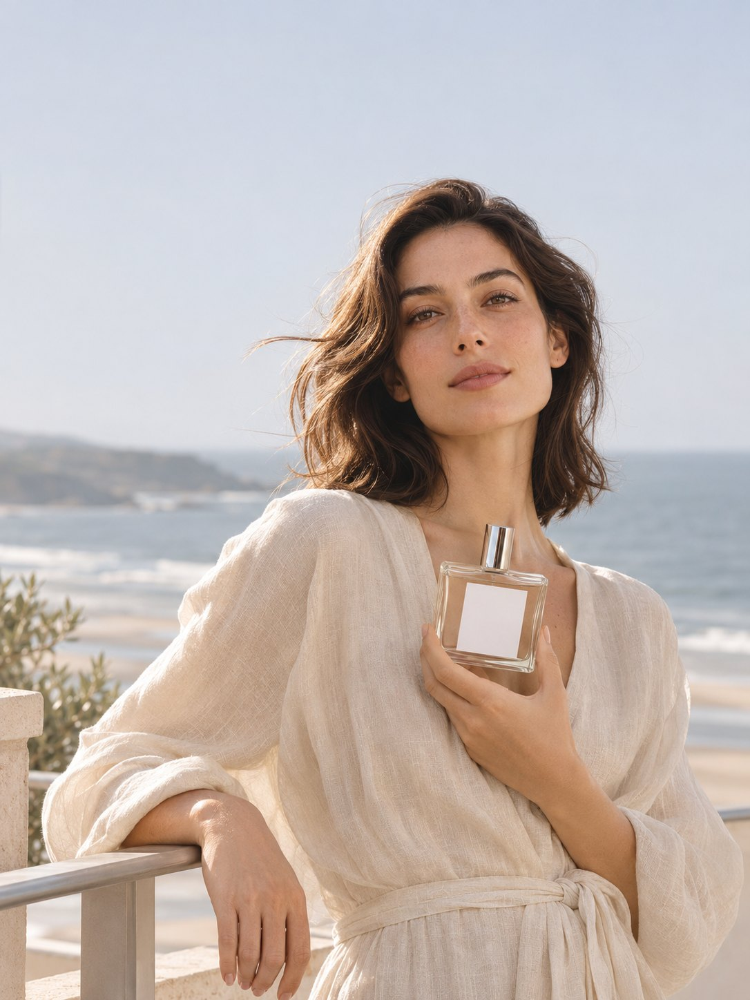
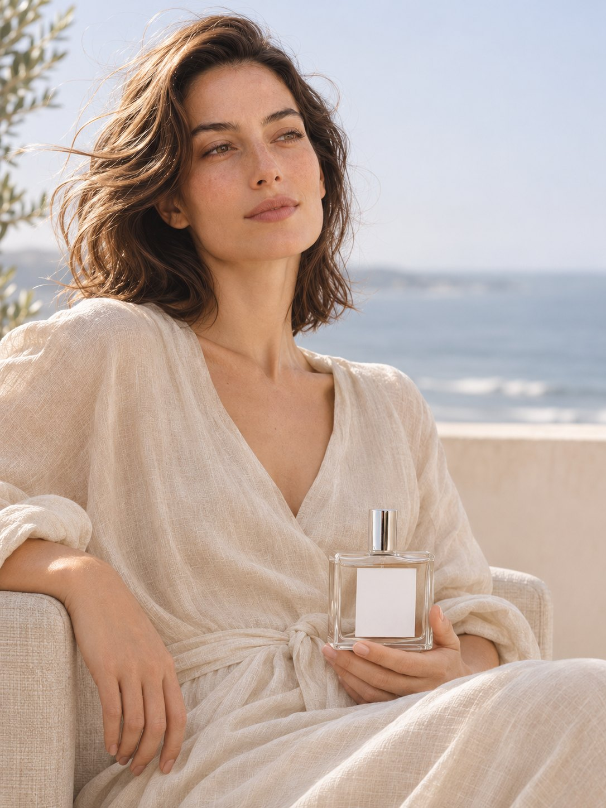
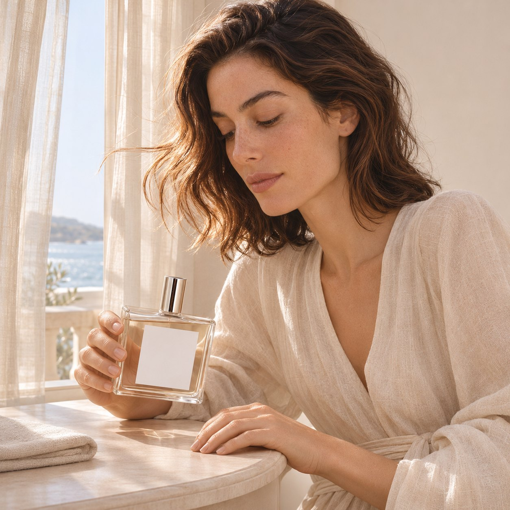
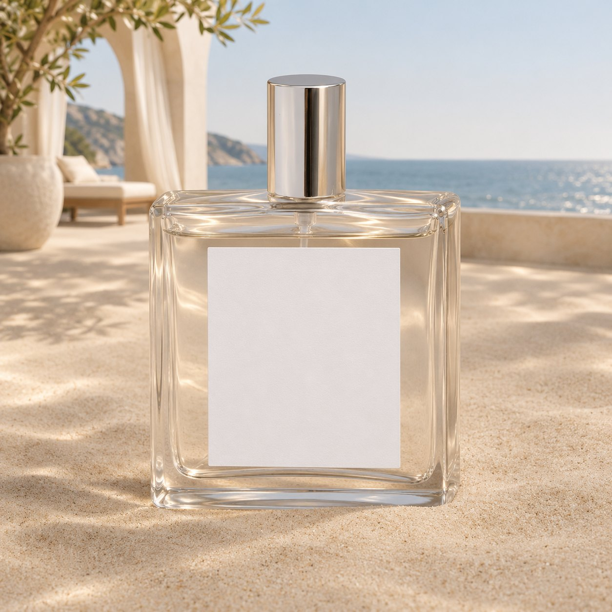
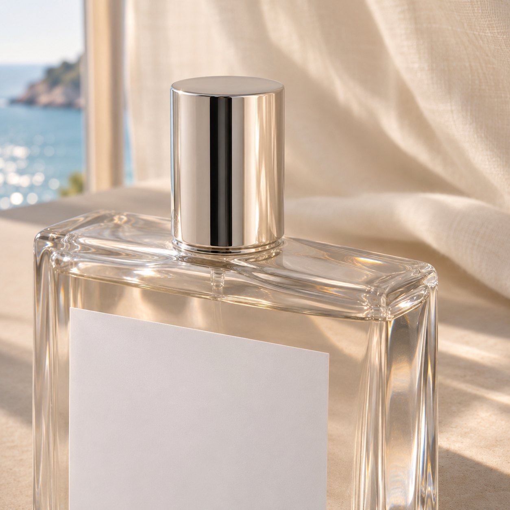
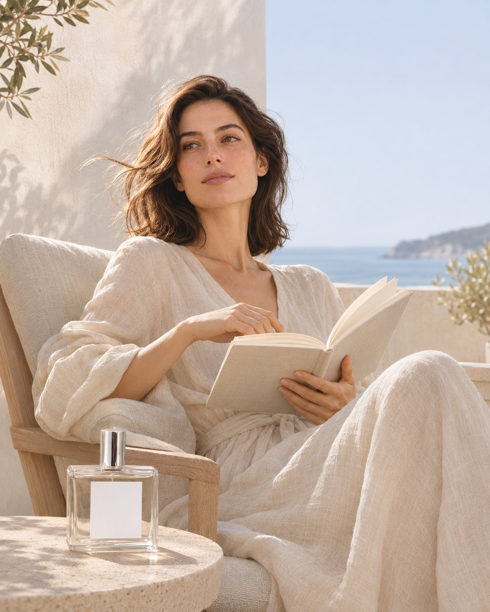
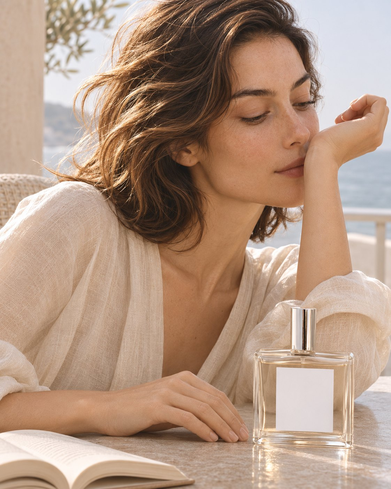

# 案例：香水 · 海岸留白 · 7 张全套组图

用 v0.1.4 Skill 在 Codex 里跑一次完整流程：用户附上产品照片，要一套全套组图、张数交给 Skill 定 → Skill 给 3 个方向和 7 张分工（5 张带模特 + 2 张产品静物）→ 用户选定方向并要求带模特的几张不要都把瓶子举在脸旁 → Skill 写出逐张方案 → 先出第 1 张，用户确认人物后，以它作为身份参考出其余带模特的镜头；静物只附产品照片。下面的需求、方向、方案、提示词与成图都是原样输出。

## 1. 产品照片

用户附上的是一张香水产品照：透明方形玻璃瓶、银色圆柱瓶盖、白色空白标签，没有品牌字样；照片里瓶子斜插在沙里，瓶底被沙挡住。照片来自 Pexels 免费图库（https://www.pexels.com/photo/clear-glass-perfume-bottle-with-silver-cap-8361540/ ），不随本仓库发布。

## 2. 需求（原话，附上产品照片）

> 这是我的香水，附图是产品照片。请为它做一套新品上市的广告大片全套组图，以带模特为主，用于电梯海报（3:4）、电商详情页（1:1）和社交媒体信息流（4:5），面向 25–38 岁女性。整套几张、每张做什么由你按需要来定，最多 8 张。先给我 3 个方向让我挑，这一步只要文字方向，不要生成任何图片。

## 3. Skill 给出的 3 个方向（原文）

> 建议做 **7 张：5 张模特主导＋2 张产品静物**，让整套既有吸引注意的上市主视觉，也有适合详情页的产品展示。
>
> 从照片可见，你的香水是透明方形玻璃瓶、银色圆柱瓶盖、白色标签，视觉上很适合克制、精致的路线。香调和品牌故事尚未提供，以下是**视觉创意方向**，不预设它具有海洋、木质或花香气味。
>
> **方向一｜海岸留白**
> *关键词：松弛、温暖、私人假日*
>
> 延续原图的沙色与透明玻璃，把产品带入一段令人向往的海边独处时光。画面以奶油白、浅沙色、银色为主，搭配亚麻、细沙与通透玻璃。
>
> 主视觉发生在海边酒店的露台：一位约 30 岁的虚构成年女性，深棕色及肩发、暖米色肌肤、棕色眼睛、清晰舒展的眉形，穿象牙白长裙，手持香水靠近锁骨，身后是虚化的海岸。人物与瓶身形成明确焦点，上方留出大面积干净空间用于后续排版。
>
> 组图延伸到窗边梳妆、露台半身肖像、颈肩与香水的近景，以及沙面玻璃瓶静物。整套表达的是“为自己留一点时间”，亲近、舒适，有质感。
>
> **适合：**希望沿用现有产品照片气质，建立温柔、松弛的新品形象。
>
> **方向二｜入夜之前**
> *关键词：都市、自信、低调张力*
>
> 用银色瓶盖与透明瓶身承接城市夜光。主色是墨黑、香槟米色和冷银，材质选择缎面、烟色玻璃与拉丝金属，整体像一部都市电影中的出门前片段。
>
> 主视觉发生在傍晚的公寓落地窗边：一位约 33 岁的虚构成年女性，黑色利落短发、暖橄榄肤色、深棕眼睛、鲜明颧骨，穿剪裁简洁的黑色露肩上衣。她已准备出门，手中的香水停在颈侧；窗外城市光点模糊，脸部与透明瓶身清晰，侧边保留标题空间。
>
> 组图围绕“出门前的最后一个动作”展开：窗边肖像、梳妆台前的停顿、手持瓶身近景、缎面上的产品静物。人物有自己的目的与节奏，情绪成熟而笃定。
>
> **适合：**希望在电梯海报里快速抓住注意力，突出都市女性的精致与存在感。
>
> **方向三｜光的收藏**
> *关键词：艺术、清透、现代雕塑感*
>
> 从方形玻璃瓶本身出发，把光线、建筑与人物组织成简洁而醒目的画面。主色是骨白、浅灰与冰蓝，材质使用半透明玻璃、浅色石材和挺括织物。
>
> 主视觉发生在午后的现代美术馆连廊：一位约 28 岁的虚构成年女性，黑色长直发收于耳后、中等暖棕肤色、深棕眼睛、修长眼型，穿结构简洁的白色无袖连衣裙。她在玻璃隔断旁停步，手持香水于胸前；人物、方瓶和建筑线条形成清晰构图，一侧白墙用于后续排版。
>
> 组图延伸到玻璃旁的人物近景、行走中的回望、手与瓶身的几何构图，以及展示瓶身边缘和银盖反光的静物。画面有艺术感，也能让产品的外观成为记忆点。
>
> **适合：**希望建立更鲜明的现代设计气质，让新品在信息流中具有辨识度。
>
> 三个方向都建议按下面的 **7 张分工**落地，每张独立构图：
>
> | 张数 | 用途与比例 | 每张承担的任务 |
> |---|---|---|
> | 1 | 电梯海报 · 3:4 | 模特＋产品主视觉，远看先识别人和香水，预留标题区 |
> | 2 | 电梯海报 · 3:4 | 更紧凑的模特半身构图，突出面部情绪与瓶身 |
> | 3 | 电商详情页 · 1:1 | 模特持香近景，展示瓶身尺寸感与使用情境 |
> | 4 | 电商详情页 · 1:1 | 产品完整静物，让消费者看清整体外观 |
> | 5 | 电商详情页 · 1:1 | 产品细节静物，突出玻璃、银盖与材质关系 |
> | 6 | 社交信息流 · 4:5 | 有故事感的模特场景，建立生活联想 |
> | 7 | 社交信息流 · 4:5 | 模特与香水的亲密近景，强化情绪记忆 |
>
> **我优先推荐方向二「入夜之前」**：人物情绪、明暗对比和银色瓶盖能形成强焦点，适合电梯与信息流的短暂观看场景。如果你更想保留原图的自然温柔感，就选方向一；更偏现代艺术品牌气质，则选方向三。
>
> 你可以直接选 **1、2 或 3**。选定后再细化这 7 张的逐张方案。

## 4. 选方向，并请 Skill 细化

Skill 推荐方向二；作者选了方向一，因为方向二的夜晚公寓与本仓库已有的卸妆油案例很接近。选定时把方向一原文和 7 张分工发回给 Skill，并加了下面这句要求（原话）：

> 请把这 7 张细化成逐张方案。5 张模特图不要都把瓶子举在脸旁或颈侧，每张换一个不同的时刻。这一步只要文字，不要生成任何图片。

## 5. Skill 写出的 7 张逐张方案（原文）

> 这套「海岸留白」可以串成一段私人假日：**窗边取香、露台停留、坐下放松、独自阅读、回味腕间气息**。五张模特图各有一个时刻，瓶子分别出现在锁骨下方、腿上、取握中的手里、边桌上和近景前景，避免反复“举瓶展示”。
>
> 整套统一使用同一位约 30 岁的虚构成年女性：深棕色及肩发、暖米色肌肤、棕色眼睛、舒展清晰的眉形。穿象牙白长裙，妆容轻薄，保留自然皮肤纹理；头发有少量被海风吹动的发丝。奶油白、浅沙色与银色贯穿七张，光线温暖而清透，避免浓重橙黄滤镜。
>
> 产品外观以附图可见特征为依据：透明扁方形玻璃瓶、银色圆柱盖、白色矩形标签。标签不新增文字，瓶身不拉长或缩窄。海岸是情绪场景，不据此推断香调或成分。
>
> **01｜把时间留给自己——电梯主海报 · 3:4**
>
> - **画面时刻：** 她走到海边酒店露台，在栏杆前停下来，像刚刚决定今天不赶任何行程。
> - **人物与动作：** 身体微侧，脸转向镜头，目光安静而有交流感。单手持香水靠近锁骨下方，瓶身落在上胸前；另一只手自然搭在栏杆上。指尖避开瓶身正面的主要区域。
> - **构图：** 取至腰部附近，人物位于中下部、略偏右。脸与瓶身形成清楚的上下关系，产品以象牙白衣料为背景，透明轮廓更容易识别。
> - **场景与光线：** 海岸虚化成淡蓝灰与沙色层次；柔和侧光照亮面部，在银盖和玻璃边缘留下清晰亮线。栏杆简洁，不横穿瓶身。
> - **排版空间：** 上方约四分之一留给后续标题，保持低细节；海平线避开头部与标题区域。
> - **承担任务：** 作为整套第一眼记忆，让人先看到她，再看到她手中的香水。保留原方向中最标志性的持香姿态，仅这一张使用。
>
> **02｜坐下来，不急着出发——电梯副海报 · 3:4**
>
> - **画面时刻：** 她已坐进露台的低背亚麻椅，肩膀放松，视线落向画外海面。
> - **人物与动作：** 双腿略朝一侧，身体轻轻转回镜头。一只手握着直立的香水瓶，松松放在靠近腰际的大腿上；另一只手搭着椅扶手。瓶子远离脸部。
> - **构图：** 从头顶取至大腿上段，人物比第一张更大。面部位于上半部，香水位于下半部中央附近，避免落到最底边。白裙作为产品背景，衣褶保持简洁。
> - **场景与光线：** 只露少量椅背、露台墙面和模糊海色，以脸部神情为主要吸引点。光线与第一张连续，面部明暗更柔和。
> - **排版空间：** 在人物视线朝向的一侧保留窄幅空白，适合短句；不再复制第一张的大面积顶部留白。
> - **承担任务：** 用更近的人物距离建立亲近感，与第一张的开阔感形成节奏变化。
>
> **03｜出门前，从窗边拿起——电商情境图 · 1:1**
>
> - **画面时刻：** 酒店窗边梳妆台前，她正把香水从台面拿起，准备带到露台。
> - **人物与动作：** 以单手自然握住瓶身侧边，瓶底刚离开台面；手指与瓶身的接触完整可见。她低头看向香水，另一只手轻扶桌沿。
> - **构图：** 方形中近景，包含侧脸、上半身、前臂与局部桌面。瓶身置于画面中部偏下，与手处于同一清晰平面；产品正面略转向镜头。
> - **场景与光线：** 奶油色薄纱窗帘、浅色梳妆台，仅留一件折好的亚麻织物。窗光穿过玻璃，瓶体边缘仍有足够对比。
> - **排版空间：** 一侧留少量干净墙面，供详情页搭配短文案，主体区域优先服务产品观看。
> - **承担任务：** 展示自然握持方式和相对尺寸感。实际容量、尺寸尚未提供，后续制作时应依据真实尺寸校准手与瓶子的比例。
>
> **04｜沙上的完整轮廓——电商产品全貌 · 1:1**
>
> - **画面时刻：** 香水独立置于细沙上，像露台生活延伸到海边的一小段停顿。
> - **产品摆位：** 瓶身直立，正面基本朝向镜头，轻微转角带出侧面厚度。盖顶、瓶肩、两侧边缘与瓶底全部入画，沙面仅轻触底部，不埋住整体轮廓。
> - **构图：** 产品居中略偏下，占画面高度约三分之二，四周留出均衡余量。相较原图的倾斜半埋姿态，这张更便于消费者看清外观。
> - **场景与光线：** 浅沙背景简洁，沙粒细腻。用宽而柔和的亮面表现透明玻璃，以稍深的边线勾出厚度；银盖保留金属反射，但不过曝。
> - **承担任务：** 成为整套外观信息最完整的一张，让消费者看清瓶型、盖型、标签位置与整体比例。
>
> **05｜光经过玻璃——电商材质细节 · 1:1**
>
> - **画面时刻：** 镜头靠近瓶体，观察银盖、瓶肩与玻璃边缘之间的材质变化。
> - **产品摆位：** 保持盖合状态，以轻微侧转的角度展示盖身、透明瓶肩及一侧玻璃厚度。现有照片未展示喷头，这张不涉及开盖结构。
> - **构图：** 银盖完整入画，下方连接瓶肩与局部瓶身，允许裁掉瓶底。以盖身到玻璃边缘形成的线条组织画面，白标签仅露出局部。
> - **场景与光线：** 产品放在浅沙色平整台面，背景为虚化的象牙白亚麻。金属呈现连续明暗层次，玻璃保留折射与细微阴影，避免处理成发光塑料。
> - **承担任务：** 补足第四张无法近看清楚的材质信息，用真实的反射与厚度表现质感。
>
> **06｜把下午留在这一页——社交故事图 · 4:5**
>
> - **画面时刻：** 她坐在露台读一本书，读到一半抬头望海，手指仍停在书页之间。
> - **人物与动作：** 双手自然参与翻书与扶书，身体舒展。香水盖好放在她身旁的小边桌上，成为私人空间里的一件随身物品。
> - **构图：** 采用较宽的环境人像，人物占画面约一半；边桌靠近镜头，香水落在下方三分之一处，瓶身前没有其他物品遮挡。人物、书与香水形成清楚的视线顺序。
> - **场景与光线：** 亚麻椅、浅色墙面、一小段海景即可。书页不出现可读文字，背景不增加餐具、鲜花等抢眼道具。
> - **排版空间：** 上方一侧保留少量墙面或天空，适合后续放一句短文案。
> - **承担任务：** 让受众联想到“我也想拥有这样的下午”，拓展香水与生活的关系。
>
> **07｜只属于自己的余韵——社交情绪近景 · 4:5**
>
> - **画面时刻：** 阅读间隙，她将手腕轻轻靠近鼻尖，短暂垂下眼睛，停留在自己的感受里。
> - **人物与动作：** 一只前臂自然支在桌边，手腕抬起，嘴角放松，不做夸张陶醉表情。另一只手松放在桌面。香水盖好立在前景，靠近休息的那只手。
> - **构图：** 取侧面或四分之三侧面的面部、颈肩、手腕与桌面局部。瓶子位于下方一侧，与脸形成对角关系；调整桌面高度及拍摄角度，让瓶子与面部距离接近，兼顾两者清晰度。
> - **场景与光线：** 背景压缩成柔软的奶油色，保留皮肤、发丝与玻璃的细节。情绪亲密，但表情与姿态保持日常。
> - **排版空间：** 以完整影像为主，只保留小幅边缘余量，适合信息流直接观看。
> - **承担任务：** 作为整套情绪收尾，用闻腕间气息的动作呼应“为自己留一点时间”，不暗示具体留香时长。
>
> 七张按以上顺序交付，分别为三个用途独立构图。五张模特图的核心区别明确为：**持香停留、坐姿休息、窗边取香、阅读望海、闻腕回味**；两张静物分别负责完整外观和局部材质，让情绪表达与产品信息都有各自的位置。

## 6. 怎么出的图

- 第 1 张只附产品照片；用户确认人物后，第 2、3、6、7 张都附两张图——附图 1 是第 1 张（只作人物身份参考），附图 2 是产品照片；第 4、5 张是产品静物，只附产品照片。
- 每张在单独的会话里出，提示词由 Skill 按模板自己写（下面每张图下可展开）；每张只出 1 次，没有挑选、没有重抽、没有局部修补，发布时只转成 JPEG。

## 7. 成图

### 第 1 张：电梯海报 3:4



<details><summary>这一张的最终提示词</summary>

```text
Create one 3:4 vertical high-end beauty advertising photograph for a new perfume launch elevator poster aimed at women aged 25–38, with the clear flat square glass bottle, cylindrical silver cap and blank white rectangular label shown in Image 1, which is a product-appearance reference only, preserving its broad flat proportions rather than elongating or narrowing it.
Set it in a seaside hotel's terrace at the quiet moment when a woman has just stopped at the railing and decided to leave her day unhurried, with a softly blurred pale blue-grey coast and sandy layers behind her, lit by soft warm clear natural sidelight illuminating her face and drawing defined bright edges along the glass and silver cap, with a cream-white, pale-sand and silver palette and no heavy orange-yellow cast, feeling like a luxury cosmetics campaign: relaxed, warm, privately escapist.
The model is a fictional synthetic adult woman around 30, with shoulder-length dark brown hair with a few sea-breeze flyaways, warm beige skin, brown eyes, and clearly defined open relaxed eyebrows, strikingly beautiful.
Compose it with her framed approximately to the waist in the middle-lower part slightly right of center, wearing an ivory-white long linen dress, body slightly turned and face turned toward the camera with quiet engaged eye contact, one hand holding the perfume just below her collarbone against the ivory fabric on her upper chest with fingers avoiding the main front face, the other hand resting naturally on a simple terrace railing that does not cross the bottle, with the face and bottle clearly arranged vertically so the viewer sees her first and the perfume next, keeping the upper approximately one-quarter of the image as clean low-detail pale sky with the horizon away from both her head and the title area for logo and headline, without shrinking the beauty result.
Show her subtle natural makeup and the perfume's transparent glass form against ivory cloth as the hero look; make its clear glass, blank white label, silver reflections and comfortable intimate quality rich and unmistakable, the product held by her or in the foreground, in elegant unbranded packaging.
Real skin texture, crisp detail. No logos, brand names, monograms or readable text; no extra products, collage or variations.
```

</details>

### 第 2 张：电梯海报 3:4



<details><summary>这一张的最终提示词</summary>

```text
Image 1 is the identity reference for the model.
Create one 3:4 vertical high-end beauty advertising photograph for a perfume in a transparent flat square glass bottle with a silver cylindrical cap and blank white rectangular label, using Image 2 as product appearance reference only, keeping the bottle's broad square proportions.
Set it in a seaside hotel's terrace in a quiet warm daylight moment, the woman already settled into a low-backed linen armchair with only a little chair back, pale terrace wall and softly blurred sea visible, with warm clear light continuous with the campaign's first image but softer facial contrast and no heavy orange-yellow filter, feeling like a luxury cosmetics campaign: relaxed, warm, private holiday.
The model is the same fictional adult woman shown in Image 1, about 30 years old, shoulder-length dark brown hair with a few windblown strands, warm beige skin, brown eyes and clearly defined relaxed eyebrows, wearing the same ivory linen long dress and light natural makeup, strikingly beautiful.
Compose it with her seated comfortably, shoulders relaxed, legs angled slightly to one side and torso gently turned back toward the camera, her gaze directed off-frame toward the sea; one hand loosely holding the perfume upright on her upper thigh close to her waist, far below her face, the other hand resting on the armrest; frame from just above her head to her upper thighs so she appears larger and more intimate than in Image 1, face in the upper half, bottle near the center of the lower half with generous clearance from the bottom edge and simple ivory dress folds behind it, keeping a narrow strip of clean softly blurred scene space on the side toward which she looks for logo and headline, without shrinking the beauty result.
Show understated natural beauty and a quiet moment of taking time for herself as the hero look; make the cream-white, pale sand and silver palette, transparent glass and breathable linen textures rich and unmistakable, the product held by her or in the foreground, in elegant unbranded packaging.
Real skin texture, crisp detail. No logos, brand names, monograms or readable text; no extra products, collage or variations.
```

</details>

### 第 3 张：电商详情页 1:1



<details><summary>这一张的最终提示词</summary>

```text
Image 1 is the identity reference for the model.
Create one 1:1 square high-end beauty advertising photograph for a perfume in a transparent flat rectangular glass bottle with a silver cylindrical cap and a blank white rectangular label; Image 2 is the product appearance reference only, preserving its broad rectangular proportions rather than elongating or narrowing it.
Set it in a seaside hotel at a pale dressing table beside a window just before she leaves for the terrace, with cream sheer curtains filtering warm clear daylight through the glass bottle, one neatly folded linen cloth as the only other object on the tabletop, feeling like a luxury cosmetics campaign: relaxed, warm, private holiday.
The model is the same fictional adult woman around 30 shown in Image 1, with shoulder-length dark brown hair, warm beige skin, brown eyes, clearly defined relaxed brows, wearing an ivory linen long dress and light natural makeup with a few softly loose strands of hair, strikingly beautiful.
Compose it with her in a square medium-close view including her side profile, upper body, both forearms and part of the tabletop, looking down at the perfume as one hand naturally grips the side of the bottle and lifts its base just a small distance above the tabletop, with the finger-to-glass contact clearly visible and her other hand lightly resting on the table edge; the bottle is in the lower middle of the composition, its blank label turned slightly toward the camera and its gripping hand and glass edges in the same sharp focal plane, keeping a small clean area of cream wall at one side for logo and headline, without shrinking the beauty result.
Show the intimate moment of picking up her perfume before heading outside as the hero look; make its clear glass, silver cap, white label and restrained cream-and-pale-sand palette rich and unmistakable, the product held by her or in the foreground, in elegant unbranded packaging.
Real skin texture, crisp detail. No logos, brand names, monograms or readable text; no extra products, collage or variations.
```

</details>

### 第 4 张：电商详情页 1:1（产品静物）



<details><summary>这一张的最终提示词</summary>

```text
Create one 1:1 square high-end beauty advertising photograph for a perfume in a transparent flattened square glass bottle with a silver cylindrical cap and a blank white rectangular label, using Image 1 only as the product appearance reference, preserving its visible proportions, cap shape and label placement without elongating or narrowing the bottle.
Set it in a quiet patch of fine pale sand beside a coastal hotel terrace in warm clear daylight, with a simple pale sandy background, broad soft luminous reflections describing transparent glass, slightly darker edge lines revealing glass thickness, and controlled silver metal reflections without blown highlights, feeling like a luxury cosmetics campaign: relaxed, warm, private.
Compose it with one bottle standing upright on the sand, its front nearly facing the camera with a slight turn revealing the side thickness, centered slightly below the middle and occupying approximately two thirds of the image height, the entire cap top, shoulders, both side edges and base visible, the sand only touching the bottom without burying the silhouette, keeping balanced clean margins of pale sand around all sides for logo and headline, without shrinking the beauty result.
Show the complete perfume bottle silhouette and clearly readable physical form as the hero look; make its clear glass, subtle glass thickness, reflective silver cylindrical cap and completely blank white rectangular label rich and unmistakable, the product in the foreground, in elegant unbranded packaging.
Real skin texture, crisp detail. No logos, brand names, monograms or readable text; no extra products, collage or variations.
```

</details>

### 第 5 张：电商详情页 1:1（产品细节静物）



<details><summary>这一张的最终提示词</summary>

```text
Create one 1:1 square high-end beauty advertising photograph for a perfume in a transparent flat square glass bottle, with a closed polished silver cylindrical cap and a blank white rectangular label, using attached Image 1 as product appearance reference only.
Set it in a seaside hotel's window-side space on a flat pale sand-coloured tabletop, with softly blurred ivory linen in the background and warm clear natural daylight, feeling like a luxury cosmetics campaign: relaxed, intimate, refined.
Compose it with an intimate material-detail close-up of the upright bottle at a slight three-quarter turn, the entire closed silver cap safely inside the frame, connected to the clear glass shoulders and upper bottle body, one thick glass side edge clearly visible, the bottle bottom cropped and only part of the blank white label showing, preserving the reference's broad flat square proportions without stretching or narrowing the bottle, keeping a small amount of soft ivory background space at the top for logo and headline, without shrinking the beauty result.
Show the transitions from polished silver cap to transparent glass shoulder to thick glass edge as the hero look; make the continuous light-to-dark metal reflections, optical refraction through transparent glass, subtle glass shadows and tangible edge thickness rich and unmistakable, the product in the foreground, in elegant unbranded packaging.
Real skin texture, crisp detail. No logos, brand names, monograms or readable text; no extra products, collage or variations.
```

</details>

### 第 6 张：信息流 4:5



<details><summary>这一张的最终提示词</summary>

```text
Image 1 is the identity reference for the model.
Create one 4:5 portrait high-end beauty advertising photograph for a perfume with a transparent flat square glass bottle, a silver cylindrical cap and a plain white rectangular label, using Image 2 as product appearance reference only, preserving its visible proportions.
Set it in a seaside hotel's private terrace during a quiet warm afternoon, with a linen lounge chair, pale plaster wall and a small softly blurred glimpse of sea, lit by clear natural afternoon daylight without an orange cast, feeling like a luxury cosmetics campaign: relaxed, warm, intimate.
The model is the same fictional adult woman from Image 1, about 30 years old, with shoulder-length dark brown hair, warm beige skin, brown eyes and defined relaxed eyebrows, wearing an ivory linen long dress and sheer natural makeup, with a few breeze-lifted strands of hair, strikingly beautiful.
Compose it with a wider environmental portrait of her seated comfortably in the linen chair, occupying about half the frame, pausing midway through reading an open book to lift her gaze toward the sea; both hands naturally involved with the book, one supporting it and the other with fingers resting between the pages, which have no readable text; a small side table beside her closer to the camera holds the closed perfume bottle in the lower third, fully visible with nothing in front of it, creating a clear visual sequence from woman to book to perfume, keeping a small uncluttered area of pale wall or sky on one upper side for logo and headline, without shrinking the beauty result.
Show the quietly aspirational personal afternoon and the transparent perfume bottle resting naturally on the side table as the hero look; make its clear glass, silver cap and blank white rectangular label, with cream-white linen and pale sand tones, rich and unmistakable, the product held by her or in the foreground, in elegant unbranded packaging.
Real skin texture, crisp detail. No logos, brand names, monograms or readable text; no extra products, collage or variations.
```

</details>

### 第 7 张：信息流 4:5



<details><summary>这一张的最终提示词</summary>

```text
Image 1 is the identity reference for the model.
Create one 4:5 vertical high-end beauty advertising photograph for a perfume whose appearance is guided only by Image 2: a transparent flat square glass bottle with a silver cylindrical cap and a plain white rectangular label, keeping its broad square proportions.
Set it in a seaside hotel's quiet reading corner beside the terrace during a pause in reading, lit by soft warm clear natural daylight, with a softly compressed cream background, ivory linen, pale sand tones and silver, feeling like a luxury cosmetics campaign: relaxed, intimate, private.
The model is the same fictional synthetic adult woman from Image 1, approximately 30 years old, with shoulder-length dark brown hair, warm beige skin, brown eyes and clearly defined relaxed eyebrows, wearing the same ivory linen dress and sheer natural makeup, strikingly beautiful.
Compose it with a close three-quarter side view of her face, neck, shoulders, wrists and part of the tabletop: she briefly lowers her eyes and brings the inner wrist of one hand gently close to her nose, with that forearm naturally supported at the table edge and her mouth relaxed in an everyday expression; her other hand rests loosely on the tabletop beside the capped perfume bottle standing upright in the lower side of the foreground; face and bottle form a diagonal, with table height and camera viewpoint bringing their distances from the camera close enough for both to retain clear detail; a small glimpse of an open book with no readable text establishes the reading pause, keeping only a small soft background margin at the edges for logo and headline, without shrinking the beauty result.
Show natural luminous skin and the clear glass perfume bottle as the hero look; make its transparent glass, silver cylindrical cap, blank white rectangular label and warm clear reflections rich and unmistakable, the product held by her or in the foreground, in elegant unbranded packaging.
Real skin texture, crisp detail. No logos, brand names, monograms or readable text; no extra products, collage or variations.
```

</details>

## 如实说明

- 这一套只出了这 7 张；项目负责人判 7 张都可用。5 张带模特的图是同一位模特（作者判定）。
- 产品外观：7 张都还原了照片里的透明方瓶、银色圆柱盖和空白标签；第 4 张的瓶底在原照片里被沙挡住，是生图时推断的。
- 衣服是亚麻罩衫配长裙，方案里写的是"象牙白长裙"；第 7 张手腕靠在唇边，看起来更像沉思，方案写的是闻手腕。
- 模特是虚构的合成成年人；实际出图提示词都没有写雀斑。
- 每次运行的结果会不同；用于商业投放前，请逐张检查手、手臂与产品的关系，以及包装上是否出现类似真实品牌的标志。
