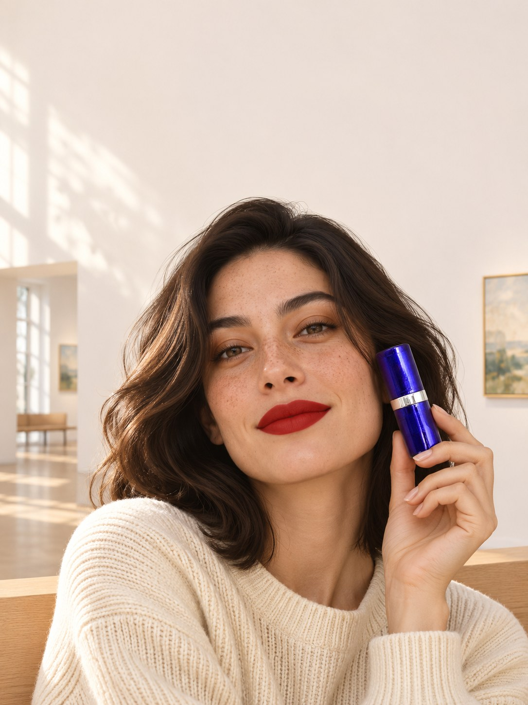
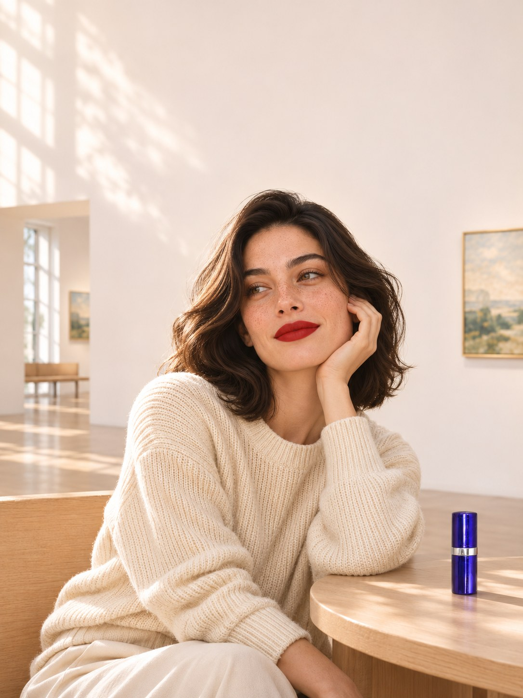

# 案例：哑光正红口红 · 午后画廊（附产品图，同一系列两张）

用 v0.1 Skill 在 Codex 里跑一次真实流程，测两件事：**用户附上自己的产品照片**，以及**同一系列后续镜头沿用同一位模特**。下面的需求、方向、规划、提示词与成图都是原样输出。

## 1. 产品照片

用户附上的是一张口红产品照：钴蓝色亮面管身、银色腰环、盖着盖子、没有品牌字样。照片来自 Pexels 免费图库（https://www.pexels.com/photo/flat-lay-of-lipsticks-4022309/ ，从三支口红里裁出蓝色那支），不随本仓库发布。

## 2. 需求（原话，附上产品照片）

> 这是我的口红，附图是产品照片，膏体是哑光正红。请为它拍带模特的广告大片，用于小红书首图（3:4），面向 25–35 岁女性。先给我 3 个方向让我挑，这一步只要文字方向，不要生成任何图片。

## 3. Skill 给出的 3 个方向（原文）

> 这支口红很适合抓住一个视觉记忆点：**冷调蓝紫色金属外壳，搭配哑光正红唇。** 三个方向都采用 3:4 竖构图，以唇色为第一视觉重点，产品靠近面部，确保缩略图里也能看清。模特均设定为虚构成年女性。
>
> 1. **蓝调时刻｜都市里的冷艳红唇**
>
>    场景是傍晚的酒店窗边，窗外城市呈深蓝色。模特约 30 岁，黑色利落短发、自然浅肤色、深棕眼睛，眉骨清晰；穿简洁黑色西装，呈现赴约前从容的一刻。
>
>    画面以面部至肩部的近景为主，哑光正红唇轮廓干净，蓝紫色管身在下颌附近露出。背景用蓝黑层次呼应外壳，上方留少量标题空间。**吸引点是成熟、自信、有距离感的美，整体最接近时装品牌广告。**
>
> 2. **午后画廊｜松弛日常中的一抹正红**
>
>    场景是午后的画廊休息区，奶油白墙面与浅木长椅构成背景。模特约 28 岁，深棕色齐肩发、暖中等肤色、棕色眼睛，鼻梁有少量雀斑；穿象牙白针织上衣，神态轻松，保留真实皮肤纹理。
>
>    用紧凑的胸像构图，正红唇成为浅色画面里最醒目的焦点，蓝紫色口红作为第二个小色块出现在脸侧。侧上方留白。**吸引点是容易代入：日常衣着也能因一抹红唇显得精致，适合小红书首图。**
>
> 3. **晚宴之前｜暖木空间里的复古正红**
>
>    场景是晚餐开始前的餐厅卡座，背景只留下深胡桃木与少量暖金色光点。模特约 33 岁，黑色侧分长卷发、暖棕肤色、深棕眼睛，嘴角有一颗小痣；穿深巧克力色缎面上衣，情绪舒展而笃定。
>
>    采用面部占比较大的近景，突出哑光唇面与缎面衣料的质感差异，产品在下巴侧下方清楚露出，顶部保留干净暗部。**吸引点是亲密、浓郁的晚间氛围，让正红唇带出赴约的仪式感。**
>
> 我更推荐 **方向 2** 作为小红书首图，人物更亲近、唇色也更突出；如果优先追求品牌大片气场，选 **方向 1**。

## 4. 第 1 张

选方向 2「午后画廊」（Skill 推荐的方向）。出图在一个新的 Codex 会话里进行，输入为：需求原话（去掉"先给我 3 个方向"一句）+ 所选方向的原文 + "按这个方向出图。恰好生成 1 张，不重试，不出变体。"，同样附上产品照片。

Skill 写出的最终提示词（原文）：

```text
Create one 3:4 vertical Xiaohongshu cover high-end beauty advertising photograph for a matte true-red lipstick, using Image 1 only as a product appearance reference for its closed glossy blue-violet cylindrical case and broad silver middle band.
Set it in an art gallery lounge on a quiet afternoon, with cream-white walls and a pale wooden bench illuminated by natural afternoon daylight, feeling like a luxury cosmetics campaign: relaxed, refined, approachable.
The model is a fictional synthetic adult woman aged about 28, with shoulder-length dark brown hair, warm medium skin, brown eyes, a few freckles across her nose, wearing an ivory knitted top with an easy relaxed expression, strikingly beautiful.
Compose it with a compact bust portrait of her seated in the gallery lounge, keeping clear cream wall space toward the upper side of the frame for logo and headline, without shrinking the beauty result.
Show matte true-red lips as the hero look; make their saturated true-red colour and velvety matte finish rich and unmistakable, the product held by her beside her face as a smaller blue-violet accent, in elegant unbranded packaging.
Real skin texture, crisp detail. No logos, brand names, monograms or readable text; no extra products, collage or variations.
```



## 5. 同一系列的后续规划

在新的会话里附上第 1 张（作为模特身份参考）和产品照片，需求原话：

> 这是我的口红，膏体是哑光正红，用于小红书图文（3:4），面向 25–35 岁女性。附图 1 是这个系列已经通过的第一张图，模特和方向都定了；附图 2 是产品照片。请为同一系列再规划 2 张不同的镜头，和第一张一起组成一组小红书图文。这一步只要文字规划，不要生成任何图片。

Skill 给出的规划（原文）：

> 这组建议按 **「首图吸引 → 近看唇妆 → 代入日常」** 排序。后两张通过景别和叙事变化，避免重复首图“手持口红贴脸”的构图。
>
> 三张统一沿用首图的深棕微卷短发、雀斑、自然眉、奶油色针织衫，以及暖白空间、浅木色和柔和日光。整体保持面向 25–35 岁女性的松弛、成熟感；环境可以暖，唇色仍须保持哑光正红，避免偏橘或偏玫红。
>
> **第 2 张｜靠近看，红唇的细节**
>
> - **作用：** 接住首图的兴趣，让读者看清颜色、哑光妆效与真实唇部质感。
> - **画面：** 3:4 竖幅面部特写，以鼻尖、双唇、下颌为主体，带入少量雀斑面颊和深棕发丝。比首图明显更近，红唇成为唯一视觉中心。
> - **状态与光感：** 表情放松，唇部自然闭合；柔和日光保留细微唇纹和皮肤纹理。哑光通过柔润、低反光的表面呈现，避免油亮高光，也不做干燥粉感。
> - **产品安排：** 不出现口红管，专注呈现上唇效果。背景只留下虚化的暖白色。
> - **与首图的区别：** 从完整人物肖像转为局部细节，减少道具和环境信息。
>
> **第 3 张｜把这抹红带进日常**
>
> - **作用：** 展示正红唇妆与日常穿着的关系，让读者代入“我也可以这样用”。
> - **画面：** 3:4 竖幅，拉远至腰部以上的环境人像。延续首图的明亮艺术空间与浅木座椅，让人物、针织衫和空间都有呼吸感；人物略偏画面一侧。
> - **状态与光感：** 像在参观间隙稍作停留，视线离开镜头，神情轻松。保留暖白墙面的日光层次，红唇仍是人物身上最鲜明的色彩。
> - **产品安排：** 闭合口红自然置于身旁的浅木台面，作为次要视觉点，与红唇形成呼应。外观参考图 2 的蓝紫色亮面管身和银色中环，不设计开盖或膏体露出的画面。
> - **与首图的区别：** 从贴脸展示转为环境中的生活片刻，以空间和穿搭完成收尾。
>
> 整体节奏是 **一张建立人物与产品印象，一张看妆效，一张看使用情境**。附图 1 继续作为后续人物一致性的参考，附图 2 用于产品外观参考；无需重新选模特或另起视觉方向。

## 6. 第 2 张：未能生成

第 2 张（红唇特写）在出图时被生图平台的输出审核拦截（分类为 sexual），没有产出图片；按"只调用 1 次、不重试"的设置，没有补跑。是否误判无法确认。如果你也需要嘴唇大特写，请留意这类镜头可能被拦截。

## 7. 第 3 张

输入为：同样的说明 + Skill 规划里的"三张统一沿用"一段和第 3 张的原文 + "按这个出图。恰好生成 1 张，不重试，不出变体。"，附上第 1 张（身份参考）和产品照片。

Skill 写出的最终提示词（原文）：

```text
Image 1 is the identity reference for the model.
Create one 3:4 vertical high-end beauty advertising photograph for a matte true-red lipstick, the third and closing image of a Xiaohongshu photo series for women aged 25–35; Image 2 is the product appearance reference only for the single closed glossy blue-violet tube with a silver middle ring.
Set it in a bright art gallery during a quiet pause in a visit, with warm white walls, pale wood seating and a pale wood tabletop beside the model, soft natural daylight with delicate sunlit layers on the wall, feeling like a luxury cosmetics campaign: relaxed, mature, quietly inviting.
The model is the same fictional adult woman around 30 from Image 1, with short softly wavy dark brown hair, lightly warm fair skin, hazel-brown eyes, freckles and natural full brows, wearing the same cream knitted sweater, strikingly beautiful.
Compose it with her slightly off-centre in a pulled-back waist-up environmental portrait, seated during a moment of rest, looking away from the camera with a relaxed expression, with breathing room around her figure, knitwear and gallery surroundings, keeping open warm white wall and softly lit gallery space beside and above her for logo and headline, without shrinking the beauty result.
Show matte true-red lips worn naturally with the cream everyday knitwear as the hero look; make the pure true-red colour and velvety matte finish rich and unmistakable, never orange or rose-magenta despite the warm environment, and the most vivid colour on the person, the single closed lipstick resting naturally on the pale wood tabletop beside her as a small secondary visual accent, at realistic lipstick scale, matching Image 2's glossy blue-violet body and silver middle ring in elegant unbranded packaging, with the cap closed and no lipstick bullet visible.
Real skin texture, crisp detail. No logos, brand names, monograms or readable text; no extra products, collage or variations.
```



## 如实说明

- 每张只出了这 1 张：没有挑选、没有重抽、没有局部修补；发布时只做了转 JPEG。
- 产品外观：两张里的口红管都还原了照片里的钴蓝亮面管身和银色腰环；第 3 张的管身比第 1 张略矮。
- 同一位模特：项目负责人判第 3 张和第 1 张是同一个人（脸型、眉形、雀斑、发型、衣服一致）。这只是一个系列、一张后续镜头，样本很小；两张是同一空间、同一身衣服，换场景或换装束后能否保持一致未测。
- 模特是虚构的合成成年人；雀斑是 Skill 在方向里自己写的，需求没有要求。
- 每次运行的结果会不同；用于商业投放前，请逐张检查手、产品结构和包装上是否出现类似真实品牌的标志。
