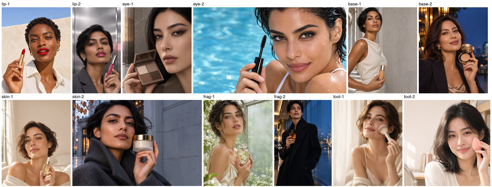

# 案例：六个品类 × 12 个需求

用当前版本的 Skill 在 Codex 里跑 12 个需求：唇、眼、底妆、护肤、香氛、工具各 2 个。每个需求先让 Skill 给 3 个文字方向，取 Skill 自己推荐的那个（没有推荐时取第 1 个），再出 1 张图。12 个需求各只出了 1 张，未挑选、未修图；下图是 12 张原样拼在一起，标签对应下表编号。

| 编号 | 需求（原话，略去"先给我 3 个方向……"一句） | 取的方向 |
|---|---|---|
| lip-1 | 为一支哑光正红色口红拍带模特的广告大片。 | 正午，红色发生 |
| lip-2 | 为一支水光玫瑰色唇釉拍带模特的广告大片，用于地铁站竖版灯箱（9:16），面向 20–28 岁通勤女性。 | 银色间隙 |
| eye-1 | 为一盘大地色四色眼影拍带模特的广告大片。 | 城市灰褐 |
| eye-2 | 为一支防水浓密睫毛膏拍带模特的广告大片，主打夏季防水不晕染，用于电商首页横版首屏（16:9）。 | 泳池出水 |
| base-1 | 为一瓶自然光泽粉底液拍带模特的广告大片。 | 石廊午后 |
| base-2 | 为一盒持妆气垫粉底拍带模特的广告大片，面向 30–40 岁职场女性，用于社交媒体竖版信息流（4:5）。 | 下班，依然在场 |
| skin-1 | 为一瓶修护精华液（滴管瓶）拍带模特的广告大片。 | 清晨归来 |
| skin-2 | 为一罐保湿面霜拍带模特的广告大片，主打秋冬干燥季，用于商场户外横版大牌（3:2）。 | 冷风中的润泽 |
| frag-1 | 为一瓶花香调女士香水拍带模特的广告大片。 | 清晨花房 |
| frag-2 | 为一瓶木质调中性香水拍带模特的广告大片，用于节日礼赠季，投放机场竖版灯箱（2:3）。 | 此刻，奔向你 |
| tool-1 | 为一把柔软的散粉刷拍带模特的广告大片。 | 晨光轻吻 |
| tool-2 | 为一个水滴形美妆蛋拍带模特的广告大片，面向刚开始学化妆的大学生，用于电商详情页首图（1:1）。 | 早八前 |

这组测试的评估结果见 README"当前证据"一节。
